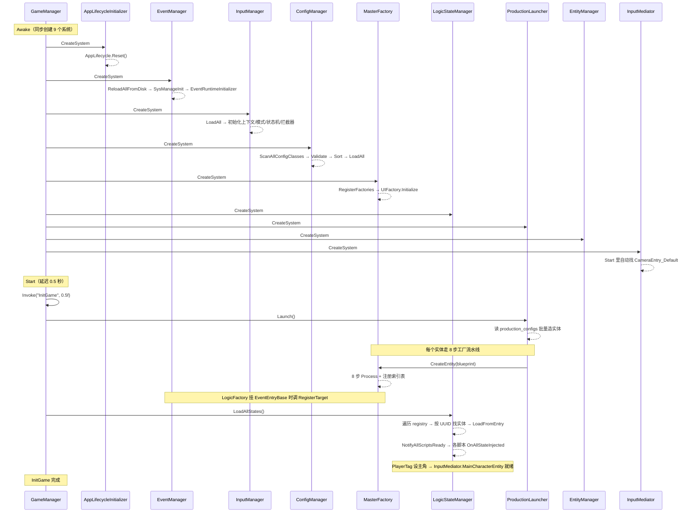

# 项目技术文档 · 第 0 章 总览

> 本文档是整个项目技术文档的**入口章**。读完后你应该能回答三个问题：
>
> 1. 这个项目有哪些系统？它们之间怎么依赖？
> 2. 游戏启动时，各系统按什么顺序初始化？
> 3. 跨系统通信靠什么契约？
>
> 后续各章（配置 / 工厂 / 逻辑状态 / 输入 / 事件 / 总控 / 上层脚本）会展开细节。
> 配套文档：《架构优点》（看设计强势点）、《已知问题与待修点》（看技术债台账）。

------

## 0.1 项目是什么

一个 **Unity 数据驱动 + 实体组件化** 的游戏框架。核心思想：

- **配置即实体**：实体长什么样、挂什么脚本、用什么物理/材质/音频，全由蓝图配置声明
- **工厂流水线造实体**：8 步工厂按固定顺序给实体挂组件
- **实体被动接收**：实体不查全局表，通道把信息送到实体面前（详见《架构优点》A1~A4）
- **事件 + 输入双通道**：输入系统发布标准化语义，事件系统投递显式信息，两者都只做通道传输

技术上分 **7 个系统**，全部由 `GameManager` 统一编排。

------

## 0.2 系统全景图

text

```
┌─────────────────────────────────────────────────────────────┐
│                        GameManager                          │
│                    （总控，统一编排启动）                      │
└─────────────────────────────────────────────────────────────┘
                              │
        ┌─────────────────────┼─────────────────────┐
        ▼                     ▼                     ▼
┌───────────────┐    ┌───────────────┐    ┌───────────────┐
│  事件系统      │    │  输入系统      │    │  配置系统      │
│ EventManager  │    │ InputManager  │    │ ConfigManager │
│               │    │               │    │               │
│ · 编辑器配置   │    │ · 上下文/模式  │    │ · 元配置驱动   │
│ · 代码生成     │    │ · 状态机       │    │ · 依赖校验     │
│ · UUID 投递   │    │ · 拦截器管道   │    │ · 自动排序     │
│ · 全局广播     │    │ · 权威快照     │    │               │
└───────────────┘    └───────────────┘    └───────────────┘
        │                     │                     │
        │                     │                     ▼
        │                     │            ┌───────────────┐
        │                     │            │  工厂系统      │
        │                     │            │ MasterFactory │
        │                     │            │               │
        │                     │            │ · 8 步流水线   │
        │                     │            │ · 蓝图组装     │
        │                     │            │ · 四张索引表   │
        │                     │            └───────────────┘
        │                     │                     │
        │                     │                     ▼
        │                     │            ┌───────────────┐
        │                     │            │ 逻辑状态系统   │
        │                     │            │ LogicStateMgr │
        │                     │            │               │
        │                     │            │ · 脚本自管数据 │
        │                     │            │ · 统一注入     │
        │                     │            │ · 保存/加载    │
        │                     │            └───────────────┘
        │                     │                     │
        ▼                     ▼                     ▼
┌─────────────────────────────────────────────────────────────┐
│                    上层逻辑脚本（LogicScriptBase）             │
│  PawnAttackRange / CameraRigScript / StateMachineScript /    │
│  CharacterInputEntry / TestEntry / PlayerTag / ...           │
└─────────────────────────────────────────────────────────────┘
```


### 系统清单

| #    | 系统         | 核心类                         | 职责                                        | 文档章  |
| :--- | :----------- | :----------------------------- | :------------------------------------------ | :------ |
| 1    | 配置系统     | `ConfigManager` / `ConfigAPI`  | 加载 JSON 配置、依赖校验、排序              | 第 1 章 |
| 2    | 工厂系统     | `MasterFactory` + 8 个 Factory | 按蓝图流水线造实体                          | 第 2 章 |
| 3    | 逻辑状态系统 | `LogicStateManager`            | 给逻辑脚本注入/保存状态                     | 第 3 章 |
| 4    | 输入系统     | `InputManager`                 | 配置驱动的输入状态机 + 权威快照             | 第 4 章 |
| 5    | 事件系统     | `EventManager`                 | 编辑器驱动的事件配置 + 代码生成 + UUID 投递 | 第 5 章 |
| 6    | 总控         | `GameManager` / `AppLifecycle` | 统一编排启动顺序、退出安全                  | 第 6 章 |
| 7    | 上层脚本     | `LogicScriptBase` 子类         | 业务逻辑（移动/相机/状态机/交互…）          | 第 7 章 |

------

## 0.3 启动时序（关键）

`GameManager.Awake` 按依赖顺序创建 9 个系统，`GameManager.Start` 延迟 0.5 秒后调 `InitGame` 初始化。




### 关键依赖点

1. **`ConfigManager` 必须在 `MasterFactory` 之前**：`MasterFactory.Awake` → `UIFactory.Initialize` 读 `ConfigAPI.Get<CanvasRegistryConfig>()`
2. **`EventManager` 必须在 `MasterFactory` 之前**：`LogicFactory` 挂 `EventEntryBase` 时调 `EventManager.Instance.RegisterTarget`
3. **`InputMediator` 必须最后**：它依赖 `MasterFactory`（查实体）和 `CameraEntry_Default`（场景预挂）
4. **`ProductionLauncher.Launch` 先于 `LogicStateManager.LoadAllStates`**：先造实体，再注入状态
5. **`PlayerTag.OnAllStateInjected` 是主角就绪信号**：`LogicStateManager.NotifyAllScriptsReady` 触发后，`PlayerTag` 设主角到 `InputMediator`

> ⚠️ 隐性依赖：脚本挂载顺序依赖蓝图 `logicScriptIds` 数组顺序（见 ISSUE-P1-002）。

------

## 0.4 跨系统契约（必读）

跨系统通信只走以下契约，不直接碰对方内部数据结构。

### 契约 1：UUID —— 实体唯一标识

- **格式**：`{tag}_{counter:D4}`，如 `Pawn_0005`（`MasterFactory.GenerateUUID`）
- **作用**：事件定点投递（`DispatchToTargets`）、状态注入（`LogicStateManager.LoadContainer`）、输入中转（`InputMediator`）、工厂查询（`FindByUUID`）
- **规范**：`UUID`/`UUIDS` 大写（见 ISSUE-P2-014）

### 契约 2：LogicScriptBase —— 逻辑脚本基类

csharp

```
public abstract class LogicScriptBase : MonoBehaviour, IEntityAware
{
    public Entity Entity { get; set; }
    public abstract string ContainerId { get; }              // 父容器配置 ID，空串=无状态
    public abstract void LoadFromEntry(ILogicStateEntry entry); // 从容器加载
    public abstract ILogicStateEntry SaveToEntry();             // 保存到容器
    public virtual void OnAllStateInjected() { }                // 全部注入完成回调
}
```


- 所有业务脚本继承它，由 `LogicFactory` 挂载、`LogicStateManager` 注入
- `ContainerId` 为空串 = 无状态脚本（如 `PlayerTag`/`ChestInteractScript`）

### 契约 3：Entity 四维状态

| 维度        | 类型                   | 含义                          | 变更事件          |
| :---------- | :--------------------- | :---------------------------- | :---------------- |
| `Lifecycle` | `EntityLifecycleState` | Alive/Dead/Destroying/Pooled  | —                 |
| `GameFlow`  | `GameFlowState`        | Normal/Paused/Cutscene/InMenu | —                 |
| `Action`    | `EntityActionState`    | Idle/Moving/Attacking/...     | `OnActionChanged` |
| `StateTags` | `HashSet<string>`      | Buff/临时标签                 | —                 |

- 快捷判断：`IsAlive` / `CanAct`
- 状态由 `StateMachineScript` 管理（S_011）

### 契约 4：Package / PackageEvent —— 事件载体

csharp

```
public class Package { Dictionary<string, object> data; Put/Get/Has/ValidateAll/ValidateFields; }
public abstract class PackageEvent { string EventClassFullName; EventQueueType QueueType; Package Package; }
```


- 弱类型包（`Package`）+ 强类型字段（生成的事件类）双轨
- `TypeNameHandling.All` 支持自定义类型跨事件（S_005/S_006 验证）

### 契约 5：InputOutputPayload —— 输入标准化输出

csharp

```
public class InputOutputPayload {
    bool HasOutput; string ActionKey; string Action; string Context;
    InputKeyState KeyState; string Device; int Frame; SelectScope Scope;
}
```


- 输入系统只发布"发生了什么"（标准化语义），不解释"这意味着什么"
- 解释权在 `CameraEntryBase` / `EntityInputEntry`

### 契约 6：入口注册（A2）+ 方法注册（A3）

| 注册         | 代码                                                 | 作用                 |
| :----------- | :--------------------------------------------------- | :------------------- |
| 实体注册     | `EventManager.RegisterTarget(UUID, EventEntryBase)`  | 只有注册的实体收事件 |
| 事件方法注册 | `EventEntryBase.RegisterMethod(methodName, handler)` | 只有注册的方法被执行 |
| 输入方法注册 | `EntityInputEntry.RegisterInput(action, handler)`    | 只有注册的输入被执行 |
| 意图注册     | `CameraEntryBase.RegisterIntent(action, handler)`    | 只有注册的意图被处理 |

------

## 0.5 目录速查

| 文档                 | 内容                                                   |
| :------------------- | :----------------------------------------------------- |
| 第 0 章（本章）      | 总览、系统全景、启动时序、跨系统契约                   |
| 第 1 章              | 配置系统：元配置、依赖校验、加载流程                   |
| 第 2 章              | 工厂系统：8 步流水线、各 Factory 职责、索引表          |
| 第 3 章              | 逻辑状态系统：父容器、注入/保存、NotifyAllScriptsReady |
| 第 4 章              | 输入系统：五层解耦、状态机、拦截器、权威快照、范围     |
| 第 5 章              | 事件系统：编辑器、代码生成、UUID 投递、全局广播        |
| 第 6 章              | 总控：GameManager 启动顺序、AppLifecycle 退出安全      |
| 第 7 章              | 上层脚本：各 LogicScriptBase 子类职责                  |
| 《架构优点》         | 结构性/模块级/工程化优点                               |
| 《已知问题与待修点》 | P0/P1/P2 台账 + 待补功能 + 关注点                      |

------

## 0.6 新人上手三步

1. **读本章 + 《架构优点》A1~A4**：理解"实体被动接收、无全局上帝"
2. **跑一次游戏，看 Console 启动日志**：对照 0.3 启动时序，确认各系统初始化顺序
3. **从第 6 章（总控）开始读**：`GameManager` 是入口，读完再按需跳读其他章

> 加新功能的典型路径：
>
> - 加配置 → 第 1 章"扩展指南"
> - 加实体 → 第 2 章"扩展指南"
> - 加有状态脚本 → 第 3 章"扩展指南"
> - 加按键/状态/拦截器/意图 → 第 4 章"扩展指南"
> - 加事件 → 第 5 章"扩展指南"

------

**第 0 章结束。**