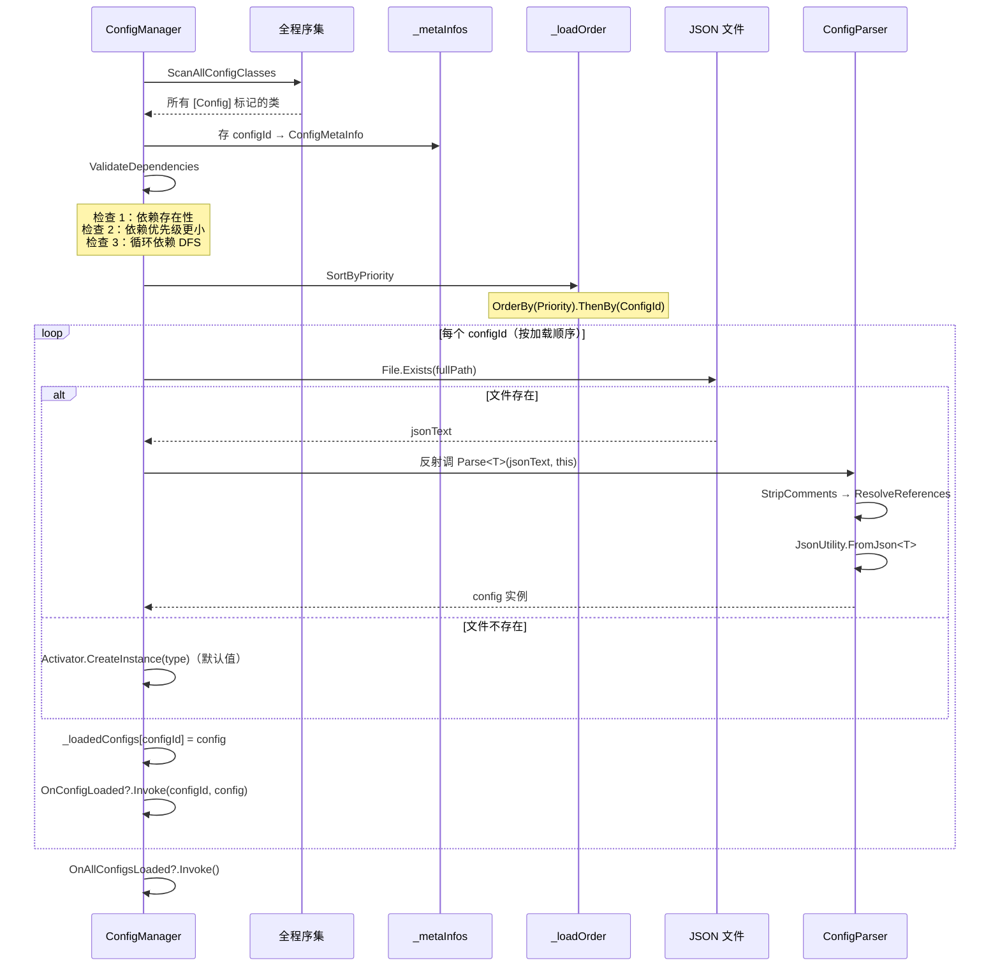

# 第 1 章 配置系统

> 本章讲配置系统：**元配置驱动、依赖校验、自动排序、加载 JSON**。
> 核心思想：用 `[Config]` 元信息描述配置类，`ConfigManager` 自动发现、校验依赖、排序加载，**加配置零注册**。
>
> 配套：《架构优点》B1（元配置驱动）、《已知问题与待修点》ISSUE-P2-001/002/003。

------

## 1.1 系统定位与职责边界

### 负责什么

| 负责                                   | 不负责                               |
| :------------------------------------- | :----------------------------------- |
| 自动扫描带 `[Config]` 的配置类         | 配置数据的业务含义（各系统自己解释） |
| 依赖校验（存在性 + 优先级 + 循环依赖） | 配置的运行时修改（配置只读）         |
| 按 `Priority` 排序加载                 | 配置热更（当前不支持）               |
| 从 JSON 加载到配置实例                 | 配置的 UI 编辑（用文本编辑器）       |
| 提供 `ConfigAPI` 统一访问入口          | 配置的版本管理                       |

### 边界

- 配置系统**纯数据**，无生命周期，随游戏销毁（Q5）
- 配置**只读**，运行时改配置应通过游戏状态系统，不改配置本身
- 配置系统**不依赖任何其他系统**，是最底层

------

## 1.2 架构与模块

### 1.2.1 模块清单

| 模块               | 文件  | 职责                                                         |
| :----------------- | :---- | :----------------------------------------------------------- |
| `ConfigAttribute`  | C_003 | 元信息标记：configId / jsonPath / priority / dependsOn       |
| `ConfigDefinition` | C_003 | 配置基类，反射读元信息                                       |
| `ConfigManager`    | C_005 | 核心管理器：扫描 → 校验 → 排序 → 加载                        |
| `ConfigParser`     | C_006 | JSON 解析：去注释 + `@ref:` 引用解析 + `JsonUtility.FromJson` |
| `ConfigBuilder`    | C_004 | JSON 生成器（无组/有组两种模式）                             |
| `ConfigAPI`        | C_002 | 静态门面：`Get<T>()` / `OnConfigLoaded` / 按字典键查找       |
| `CreatConfig`      | C_007 | 测试配置生成器（一键生成所有测试 JSON）                      |

### 1.2.2 分层结构

text

```
┌─────────────────────────────────────────────────────────┐
│                    ConfigAPI（门面）                      │
│  Get<T>() / OnConfigLoaded<T> / GetPhysicsConfig 等      │
└─────────────────────────────────────────────────────────┘
                            │
┌─────────────────────────────────────────────────────────┐
│                  ConfigManager（管理器）                  │
│  ScanAllConfigClasses → ValidateDependencies             │
│  → SortByPriority → LoadAllConfigs                       │
└─────────────────────────────────────────────────────────┘
                            │
        ┌───────────────────┼───────────────────┐
        ▼                   ▼                   ▼
┌──────────────┐  ┌──────────────┐  ┌──────────────┐
│ ConfigParser │  │ ConfigBuilder│  │  各配置类     │
│ 解析 JSON     │  │ 生成 JSON    │  │ [Config] 标记 │
└──────────────┘  └──────────────┘  └──────────────┘
```


### 1.2.3 配置清单（12 个）

| configId               | 优先级 | 依赖                                                         | 用途                 |
| :--------------------- | :----- | :----------------------------------------------------------- | :------------------- |
| `audio_configs`        | 100    | —                                                            | 音频片段配置         |
| `camera_registry`      | 50     | —                                                            | 摄像机注册表         |
| `canvas_registry`      | 50     | —                                                            | 画布注册表           |
| `entity_blueprints`    | 200    | logic_scripts / object_pools / physics_configs / material_database | 实体蓝图             |
| `logic_scripts`        | 100    | —                                                            | 逻辑脚本注册表       |
| `logic_state_registry` | 50     | —                                                            | 逻辑状态父容器注册表 |
| `map_cache`            | 50     | —                                                            | 地图缓存（预留）     |
| `map_overview`         | 100    | —                                                            | 地图总览             |
| `map_placements`       | 1000   | map_overview / entity_blueprints                             | 地图放置             |
| `material_database`    | 100    | —                                                            | 材质数据库           |
| `object_pools`         | 100    | —                                                            | 对象池配置           |
| `physics_configs`      | 100    | —                                                            | 物理配置             |
| `production_configs`   | 100    | —                                                            | 批量生产配置         |
| `terrain_configs`      | 100    | —                                                            | 地形配置（计划删除） |
| `ui_blueprints`        | 200    | ui_prefabs / logic_scripts / canvas_registry / camera_registry | UI 蓝图              |
| `ui_prefabs`           | 100    | —                                                            | UI 预制体            |

> 注：`logic_state_pawn_attack_range` / `logic_state_camera_rig` / `entity_state_machine` 是逻辑状态父容器，由逻辑状态系统管理，不走主配置系统的加载顺序（它们是 `LogicStateManager` 运行时按需加载的）。

------

## 1.3 核心数据结构

### 1.3.1 `ConfigAttribute`（元信息）

csharp

```c#
[AttributeUsage(AttributeTargets.Class, Inherited = false)]
public class ConfigAttribute : Attribute
{
    public string ConfigId { get; }       // 唯一标识
    public string JsonPath { get; }       // JSON 文件名（默认 {configId}.Json）
    public int Priority { get; }          // 优先级（越小越先加载）
    public string[] DependsOn { get; }    // 依赖的配置 ID

    public ConfigAttribute(string configId, string jsonPath = null,
        int priority = 100, params string[] dependsOn) { ... }
}
```


### 1.3.2 `ConfigDefinition`（配置基类）

csharp

```c#
public abstract class ConfigDefinition
{
    public string ConfigId => GetType().GetCustomAttribute<ConfigAttribute>()?.ConfigId ?? GetType().Name;
    public int Priority => GetType().GetCustomAttribute<ConfigAttribute>()?.Priority ?? 100;
    public string[] DependsOn => GetType().GetCustomAttribute<ConfigAttribute>()?.DependsOn ?? Array.Empty<string>();
}
```


- 反射读元信息，子类零样板
- 子类只需 `[Config(...)]` + 继承 + 定义数据字段

### 1.3.3 `ConfigManager` 内部结构

csharp

```c#
public class ConfigManager : MonoBehaviour
{
    private static ConfigManager _instance;
    private readonly Dictionary<string, ConfigDefinition> _loadedConfigs = new();  // 已加载
    private readonly Dictionary<string, ConfigMetaInfo> _metaInfos = new();       // 元信息
    private readonly List<string> _loadOrder = new();                             // 加载顺序

    public event Action<string, ConfigDefinition> OnConfigLoaded;
    public event Action OnAllConfigsLoaded;
}
```


------

## 1.4 运行时流程

### 1.4.1 加载流程（`Awake` 里同步执行）




### 1.4.2 依赖校验（三检查）

csharp

```c#
private void ValidateDependencies()
{
    foreach (var metaInfo in _metaInfos.Values)
    {
        foreach (var depId in metaInfo.DependsOn)
        {
            // 检查 1：依赖存在
            if (!_metaInfos.ContainsKey(depId)) { Debug.LogError(...); continue; }

            // 检查 2：依赖优先级更小（先加载）
            if (_metaInfos[depId].Priority >= metaInfo.Priority) { Debug.LogError(...); }
        }
    }

    // 检查 3：循环依赖 DFS
    CheckCircularDependencies();
}
```


**优先级规则**：被依赖的配置 `Priority` 必须**更小**（更早加载）。如 `entity_blueprints`(200) 依赖 `logic_scripts`(100)，100 < 200 ✅。

### 1.4.3 依赖图（实际项目）

text

```c#
优先级 50（最先加载）
├─ camera_registry
├─ canvas_registry
├─ logic_state_registry
└─ map_cache

优先级 100
├─ audio_configs
├─ logic_scripts
├─ material_database
├─ object_pools
├─ physics_configs
├─ production_configs
├─ terrain_configs
├─ ui_prefabs
├─ map_overview
└─ logic_state_*（运行时按需）

优先级 200（依赖 100 的配置）
├─ entity_blueprints ← logic_scripts / object_pools / physics_configs / material_database
└─ ui_blueprints    ← ui_prefabs / logic_scripts / canvas_registry / camera_registry

优先级 1000（最后加载）
└─ map_placements ← map_overview / entity_blueprints
```


------

## 1.5 配置说明

### 1.5.1 加一个配置类的完整流程

**Step 1：写配置类**

csharp

```c#
using System;
using UnityEngine;

[Serializable]
[Config(
    configId: "my_config",
    priority: 100,
    dependsOn: new[] { "other_config" }  // 可选
)]
public class MyConfig : ConfigDefinition
{
    public MyData[] items;

    [Serializable]
    public class MyData
    {
        public string id;       // 字典键
        public float value;
    }
}
```


**Step 2：写 JSON**

文件路径：`Assets/Config/ConfigData/my_config.json`（`configId` + `.json`）

json

```json
{
  "items": [
    { "id": "item_01", "value": 1.5 },
    { "id": "item_02", "value": 2.0 }
  ]
}
```


**Step 3：访问配置**

csharp

```c#
// 方式 1：按类型取
var config = ConfigAPI.Get<MyConfig>();

// 方式 2：按 ID 取
var config = ConfigAPI.Get<MyConfig>("my_config");

// 方式 3：等配置就绪
ConfigAPI.OnConfigLoaded<MyConfig>(cfg => { /* 用 cfg */ });

// 方式 4：按字典键查（ConfigManager.FindByKey）
var item = ConfigManager.Instance.FindByKey<MyConfig.MyData>("my_config", "id", "item_01");
```


**完成**。不需要注册，`ConfigManager` 自动扫描到。

### 1.5.2 JSON 语法约定

| 语法                               | 说明                                             |
| :--------------------------------- | :----------------------------------------------- |
| `// 注释`                          | `ConfigParser.StripComments` 会去掉              |
| `/* 块注释 */`                     | 同上                                             |
| `@ref:configId.field[index].field` | 引用其他配置的值（**预留未使用**，ISSUE-P2-003） |

### 1.5.3 配置生成（`ConfigBuilder`）

**两种模式**：

| 模式             | 调用                                   | 生成结构       |
| :--------------- | :------------------------------------- | :------------- |
| 无组模式（主流） | `builder.Add(key, value)` 或 `AddRoot` | 顶层就是字段名 |
| 有组模式         | `builder.Group("组名").Add(...)`       | 顶层是组名     |

**`CreatConfig`（C_007）** 是测试配置生成器，`Start` 里一键生成所有测试 JSON。正式项目应改为编辑器工具或手写 JSON。

### 1.5.4 按字典键查找（`FindByKey`）

csharp

```c#
public T FindByKey<T>(string configId, string keyField, string keyValue) where T : class
{
    var config = GetConfigRaw(configId);
    var arrayField = config.GetType().GetFields().FirstOrDefault(f => f.FieldType.IsArray);
    var array = arrayField.GetValue(config) as Array;
    foreach (var item in array)
    {
        var keyFieldInfo = item.GetType().GetField(keyField);
        if (keyFieldInfo.GetValue(item)?.ToString() == keyValue) return item as T;
    }
    return null;
}
```


**快捷方法**：

- `FindPhysicsConfig(id)` → `physics_configs` 的 `configId`
- `FindMaterialConfig(id)` → `material_database` 的 `materialId`
- `FindLogicScript(id)` → `logic_scripts` 的 `scriptId`
- `FindObjectPool(id)` → `object_pools` 的 `poolId`
- `FindAudioConfig(id)` → `audio_configs` 的 `audioId`
- `FindTerrainConfig(id)` → `terrain_configs` 的 `terrainId`

> ⚠️ `FindByKey` 只找**第一个数组字段**（ISSUE-P2-002）。当前所有配置类只有一个数组字段，无影响。

------

## 1.6 扩展指南

### 加一个新配置类

见 1.5.1，三步完成。

### 加一个"配置引用配置"的字段

csharp

```c#
[Config(configId: "my_config", priority: 100)]
public class MyConfig : ConfigDefinition
{
    public string[] otherConfigIds;  // 引用其他配置的 ID
}
```


**规范**：引用字段命名统一为 `xxxConfigId` 或 `xxxIds`，被引用的配置必须在 `dependsOn` 里声明。

### 加一个配置生成器（编辑器工具）

参考 `CreatConfig`（C_007），改为 `EditorWindow` 或 `MenuItem`，避免运行时生成。

### 加一个 `@ref:` 引用

**当前未使用**（ISSUE-P2-003）。如需使用：

json

```json
{
  "configId": "my_config",
  "refField": "@ref:other_config.someField[0].value"
}
```


`ConfigParser.ResolveReferences` 会替换为实际值。**注意**：`@ref:` 前必须是引号。

------

## 1.7 已知限制与注意事项

| 编号         | 问题                                                    | 优先级 |
| :----------- | :------------------------------------------------------ | :----- |
| ISSUE-P2-001 | `ConfigAttribute` 默认 `.Json` 大写，Linux/Mac 打包隐患 | P2     |
| ISSUE-P2-002 | `FindByKey` 只找第一个数组字段                          | P2     |
| ISSUE-P2-003 | `@ref:` 语法预留未使用                                  | P2     |
| ISSUE-P2-004 | 地图缓存/地形配置预留未启用                             | P2     |

### 设计约定

- **配置只读**，运行时改配置走游戏状态系统
- **父容器数组字段必须叫 `entries`**（NOTE-004，逻辑状态系统依赖此约定）
- **父容器 ConfigId 必须与配置文件名一致**（NOTE-003，逻辑状态系统依赖此约定）
- **被依赖的配置 `Priority` 必须更小**（ValidateDependencies 检查 2）
- **`JsonUtility` 限制**：不支持 `Dictionary` 直接序列化（所以输入系统用 Newtonsoft，主配置系统不用）

### 隐性依赖

- `ConfigManager.LoadConfig` 用反射调 `ConfigParser.Parse<T>`，`ConfigParser` 是静态类
- `ConfigAttribute` 构造时 `JsonPath = jsonPath ?? $"{configId}.Json"`，`.Json` 大写（ISSUE-P2-001）
- `ConfigManager.LoadConfig` 里 `JsonPath = attr.JsonPath ?? $"{attr.ConfigId}.json"`，`.json` 小写，但 `attr.JsonPath` 永远非空（构造时已赋值），所以 `??` 右边不执行

------

## 1.8 依赖关系

text

```
ConfigManager（配置系统）
    │
    ├─ 依赖：无（最底层）
    │
    ├─ 被依赖：
    │   ├─ MasterFactory（UIFactory.Initialize 读 CanvasRegistryConfig/CameraRegistryConfig）
    │   ├─ LogicStateManager（读父容器配置）
    │   ├─ ProductionLauncher（读 production_configs）
    │   ├─ CameraRigScript（读 CameraRegistryConfig）
    │   ├─ MapFactory（读 MapOverviewConfig/MapPlacementsConfig/TerrainConfigs）
    │   └─ 各工厂（读 physics_configs/material_database/logic_scripts/object_pools/audio_configs）
    │
    └─ 对外接口：ConfigAPI.Get<T>() / ConfigManager.FindXxxConfig(id)
```


**被谁依赖**：几乎所有系统（配置是数据源）

**依赖谁**：无（最底层，不依赖任何系统）

------

**第 1 章结束。**