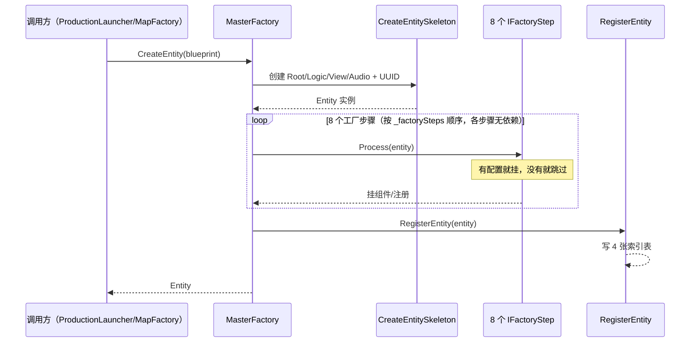

# 第 2 章 工厂系统

> 本章讲工厂系统：**声明式配置 + 8 步流水线 + 四张索引表**。
> 核心思想：蓝图声明"要什么"，工厂流水线按固定流程"怎么造"，四张索引表提供四维查询。
>
> **重要前提**：流水线**不是依赖图**。工厂步骤之间**没有依赖关系**，顺序只是挂载流程。物理/渲染/音频"蓝图有就挂，没有就跳过"，彼此独立。唯一的隐性依赖在 `LogicFactory` 内部（逻辑脚本之间），见 ISSUE-P1-002。
>
> 配套：《架构优点》A1/A2/A5/B2/B3、《已知问题与待修点》ISSUE-P1-002/003/006/007、ISSUE-P2-019/020/022。

------

## 2.1 系统定位与职责边界

### 负责什么

| 负责                                    | 不负责                               |
| :-------------------------------------- | :----------------------------------- |
| 按蓝图创建实体（8 步流水线挂载）        | 蓝图配置数据的业务含义（配置系统管） |
| 挂载组件（模型/物理/逻辑/渲染/音频/UI） | 逻辑脚本的具体逻辑（上层脚本管）     |
| 四维索引（UUID/Tag/Blueprint/Type）     | 状态注入（逻辑状态系统管）           |
| 实体销毁（唯一权威入口）                | 事件投递（事件系统管）               |
| 对象池管理（预热/批量）                 | 输入处理（输入系统管）               |
| 批量生产（ProductionLauncher）          | 地图摆放（地图工厂管，当前不启用）   |

### 边界

- 工厂**只造骨架**，不注入数据（数据注入是 `LogicStateManager` 的第二步，Q9）
- 工厂**只挂脚本**，不调脚本逻辑（`LogicFactory` 挂载后不调 `OnAllStateInjected`，等状态管理器统一调）
- 工厂是**实体生命周期的唯一权威**（`DestroyEntity` 是唯一销毁入口，A5）
- 工厂**不负责组件之间的依赖**：物理/渲染/音频"蓝图有就挂"，逻辑脚本需要知道物理状态时自己 `GetComponent` 查

------

## 2.2 架构与模块

### 2.2.1 模块清单

| 模块                 | 文件  | 流水线步骤 | 职责                                                 |
| :------------------- | :---- | :--------- | :--------------------------------------------------- |
| `MasterFactory`      | F_012 | —          | 总工厂：持有流水线、四张索引表、销毁权威             |
| `EntityFactory`      | F_005 | 1          | 加载模型 / 设默认位置 / 挂 `EntityMono`              |
| `PhysicsFactory`     | F_008 | 2          | 刚体 + 四类碰撞体（有 `physicsConfigId` 才挂）       |
| `LogicFactory`       | F_006 | 3          | 反射挂逻辑脚本 + 注册 + 注入 Entity + 事件入口初始化 |
| `RenderFactory`      | F_010 | 4          | 材质 / 阴影 / Layer（有 `materialId` 才挂）          |
| `AudioFactory`       | F_004 | 5          | AudioSource + 播放模式（有 `audioIds` 才挂）         |
| `PoolFactory`        | F_009 | 6          | 对象池（预热/批量）                                  |
| `UIFactory`          | F_011 | 7          | UI 实例化到画布 + 层级/排序/穿透（UI 蓝图才处理）    |
| `MapFactory`         | F_007 | 8          | 地图摆放（当前不启用，单实体处理留空）               |
| `ProductionLauncher` | F_013 | —          | 读 production_configs 批量造实体                     |
| `EntityManager`      | F_014 | —          | 批量操作中转层（不直接碰 MasterFactory）             |

### 2.2.2 流水线（挂载流程，无依赖）

text

```
CreateEntity(blueprint)
    │
    ├─ CreateEntitySkeleton（Root/Logic/View/Audio 四层 + UUID）
    │
    ├─ 1. EntityFactory     → 加载模型到 View，挂 EntityMono
    ├─ 2. PhysicsFactory    → 有 physicsConfigId 就挂 Rigidbody + Collider，没有跳过
    ├─ 3. LogicFactory      → 有 logicScriptIds 就挂脚本（内部有隐性依赖）
    ├─ 4. RenderFactory     → 有 materialId 就设材质/阴影/Layer，没有跳过
    ├─ 5. AudioFactory      → 有 audioIds 就加 AudioSource，没有跳过
    ├─ 6. PoolFactory       → 有 poolId 就记录归属池（预热模式跳过入池）
    ├─ 7. UIFactory         → UI 蓝图才处理，实例化到画布
    ├─ 8. MapFactory        → 单实体处理留空（批量摆放走 LoadMap）
    │
    └─ RegisterEntity（4 张索引表）
```


### 2.2.3 流水线顺序不是依赖顺序

**这是本章最重要的认知点**：

- **工厂步骤之间没有依赖关系**。顺序只是"挂载流程"，每一步只管"我的配置有没有，有就挂，挂完就完，不等别人"。
- **物理/渲染/音频彼此完全独立**：蓝图有 `physicsConfigId` 就挂物理，有 `materialId` 就挂渲染，有 `audioIds` 就挂音频，**没有就不挂，顺序不影响结果**。
- **`EntityFactory` 排第一，是因为后续步骤要拿 `entity.Renderer`/`entity.ModelInstance` 这些引用**（不是依赖，是"引用已就绪"）。
- **`LogicFactory` 排第三、`RenderFactory` 排第四** 这些顺序，不影响物理/渲染/音频的挂载结果，只是执行次序。
- **唯一的隐性依赖在 `LogicFactory` 内部**：逻辑脚本之间可能有依赖（如 `CharacterInputEntry` 需要 `EventEntryBase` 先挂），所以 `logicScriptIds` 数组顺序重要（ISSUE-P1-002）。

**"物理/渲染/音频之间的需要关系"由逻辑脚本自己处理**：比如某个逻辑需要改碰撞体，它在脚本里 `GetComponent<Collider>()` 去查，不靠工厂顺序。工厂只负责"蓝图有就挂"，不负责"谁依赖谁"。

### 2.2.4 四张索引表

csharp

```c#
private readonly Dictionary<string, List<Entity>> _entitiesByTag = new();
private readonly Dictionary<string, Entity> _entitiesByUUID = new();
private readonly Dictionary<string, List<Entity>> _entitiesByBlueprint = new();
private readonly Dictionary<EntityType, List<Entity>> _entitiesByType = new();
```


| 表           | Key         | Value        | 查询方法                          |
| :----------- | :---------- | :----------- | :-------------------------------- |
| UUID 表      | UUID        | Entity       | `FindByUUID`                      |
| Tag 表       | Tag         | List<Entity> | `FindFirstByTag` / `FindAllByTag` |
| Blueprint 表 | blueprintId | List<Entity> | `FindByBlueprint`                 |
| Type 表      | EntityType  | List<Entity> | `FindByType`                      |

------

## 2.3 核心数据结构

### 2.3.1 `Entity`（四层结构 + 四维状态）

csharp

```c#
public class Entity
{
    // 标识
    public string EntityId;          // 蓝图 ID
    public string UUID;              // 唯一标识（自动生成）
    public string Tag;               // Tag
    public EntityType EntityType;    // Normal/UI/Map/Audio

    // 四层结构
    public GameObject Root;          // 根节点
    public GameObject LogicObject;   // 逻辑体（挂物理/逻辑脚本）
    public GameObject ViewObject;    // 视觉体（挂模型）
    public GameObject AudioObject;   // 音频体（挂 AudioSource）

    public EntityBlueprintBase Blueprint;

    // 渲染/音频引用
    public Renderer Renderer;
    public GameObject ModelInstance;
    public AudioSource AudioSource;
    public List<AudioSource> AudioSources = new();

    // 池标记
    public bool IsPooled;

    // 逻辑脚本列表
    public List<MonoBehaviour> LogicScripts = new();

    // 四维状态
    public EntityLifecycleState Lifecycle { get; set; } = EntityLifecycleState.Alive;
    public GameFlowState GameFlow { get; set; } = GameFlowState.Normal;
    public EntityActionState Action { get; set; } = EntityActionState.Idle;
    private readonly HashSet<string> _stateTags = new();

    // 事件
    public event Action<EntityActionState, EntityActionState> OnActionChanged;

    // 快捷判断
    public bool IsAlive => Lifecycle == EntityLifecycleState.Alive;
    public bool CanAct => IsAlive && GameFlow == GameFlowState.Normal
                          && Action != EntityActionState.Stunned
                          && Action != EntityActionState.Hit;
}
```


### 2.3.2 `EntityBlueprintBase`（蓝图基类）

csharp

```c#
[Serializable]
public abstract class EntityBlueprintBase
{
    public string blueprintId;         // 蓝图 ID
    public string tag;                 // Tag
    public float defaultHeight = 1.0f; // 默认高度
    public string[] logicScriptIds;    // 逻辑脚本 ID 列表
    public string physicsConfigId;     // 物理配置 ID
    public string materialId;          // 材质 ID
    public string[] audioIds;          // 音频 ID 列表
    public string poolId;              // 对象池 ID
}
```


### 2.3.3 `EntityBlueprint` / `UIBlueprint`（子类特质）

csharp

```c#
// 普通实体
public class EntityBlueprint : EntityBlueprintBase
{
    public string modelPath;          // 模型路径
}

// UI 实体
public class UIBlueprint : EntityBlueprintBase
{
    public string prefabPath;         // UI 预制体路径
    public string canvasName;         // 所属画布 ID
    public int sortingOrder;          // SiblingIndex（注意：不是 Canvas.sortingOrder）
    public string uiLayer;            // background/normal/popup/tooltip/overlay
    public bool raycastTarget;        // 是否可穿透
    public bool alwaysOnTop;          // 是否始终顶层
}
```


**共性 vs 特质**（Q16）：

- 共性（`EntityBlueprintBase`）：所有实体都有
- 特质（子类）：3D 实体有 `modelPath`，UI 实体有 `prefabPath`/`canvasName` 等
- 复杂实体（人有多模型/材质/碰撞体）：`modelPath` 指向预制体，`physicsConfigId`/`materialId` 留空，脚本运行时 `GetComponent` 自取

------

## 2.4 运行时流程

### 2.4.1 创建实体（`CreateEntity`）




**代码**（F_012）：

csharp

```c#
public Entity CreateEntity(EntityBlueprintBase blueprint)
{
    if (blueprint == null) return null;
    var entity = CreateEntitySkeleton(blueprint);
    foreach (var factory in _factorySteps) factory.Process(entity);
    RegisterEntity(entity);
    TotalEntityCount++;
    return entity;
}
```


### 2.4.2 UUID 生成

csharp

```c#
private readonly Dictionary<string, int> _entityCounters = new();

private string GenerateUUID(string tag)
{
    if (!_entityCounters.ContainsKey(tag)) _entityCounters[tag] = 0;
    _entityCounters[tag]++;
    return $"{tag}_{_entityCounters[tag]:D4}";  // 如 Pawn_0005
}
```


**格式**：`{tag}_{counter:D4}`，按 Tag 独立计数。

### 2.4.3 各 Factory 职责

#### EntityFactory（第 1 步）

csharp

```c#
public void Process(Entity entity)
{
    switch (entity.Blueprint)
    {
        case EntityBlueprintsConfig.EntityBlueprint eb:
            LoadModel(entity, eb);              // 加载模型到 View
            SetDefaultPosition(entity, eb);    // (0, defaultHeight, 0)
            AddEntityComponent(entity);        // 挂 EntityMono
            break;
        case UIBlueprintsConfig.UIBlueprint ub:
            entity.Root.transform.position = Vector3.zero;  // UI 归零
            AddEntityComponent(entity);
            break;
    }
}
```


- **普通实体**：加载模型 → 设默认位置 → 挂 `EntityMono`
- **UI 实体**：只归零位置 + 挂 `EntityMono`（实际挂载由 `UIFactory` 处理）
- **无依赖**：这一步是流水线起点，为后续步骤提供 `entity.Renderer`/`entity.ModelInstance` 引用

#### PhysicsFactory（第 2 步）

csharp

```c#
public void Process(Entity entity)
{
    if (entity.Blueprint is not EntityBlueprint blueprint) return;
    if (string.IsNullOrEmpty(blueprint.physicsConfigId)) return;

    var physicsConfig = ConfigManager.Instance.FindPhysicsConfig(blueprint.physicsConfigId);
    AddRigidbody(entity.LogicObject, physicsConfig);
    AddColliders(entity.LogicObject, physicsConfig);
}
```


- **只处理普通实体蓝图**（`EntityBlueprint`），UI 实体跳过
- 四类碰撞体：`capsule` / `sphere` / `box` / `mesh`
- **无依赖**：蓝图有 `physicsConfigId` 就挂，没有就跳过；物理组件和其他工厂步骤无关
- ⚠️ `AddMeshCollider` 里 `GetComponentInParent<Entity>()` 是 bug（ISSUE-P1-003）

#### LogicFactory（第 3 步）—— 唯一有隐性依赖的步骤

csharp

```c#
public void Process(Entity entity)
{
    var logicScriptIds = entity.Blueprint.logicScriptIds;
    foreach (var scriptId in logicScriptIds)
    {
        var scriptConfig = ConfigManager.Instance.FindLogicScript(scriptId);
        var component = AttachScript(entity.LogicObject, scriptConfig);

        if (component != null)
        {
            entity.LogicScripts.Add(component);

            // 注册到 MasterFactory（供 LogicStateManager 查）
            if (component is LogicScriptBase logicScript)
                MasterFactory.Instance.RegisterScript(logicScript);

            // 注入 Entity
            if (component is IEntityAware entityAware)
                entityAware.Entity = entity;

            // 找事件入口
            EventEntryBase eventEntry = null;
            foreach (var s in entity.LogicScripts)
                if (s is EventEntryBase entry) { eventEntry = entry; break; }

            // 注入并初始化
            if (eventEntry != null)
            {
                foreach (var s in entity.LogicScripts)
                    if (s is INeedEventEntry need) need.EventEntry = eventEntry;
                eventEntry.Initialize();  // 注册方法 + RegisterTarget(UUID)
            }
        }
    }
}
```


**三个关键动作**：

1. **注册到 MasterFactory**：`RegisterScript(logicScript)` → 供 `LogicStateManager.GetScriptsByType` 查
2. **注入 Entity**：`IEntityAware.Entity = entity`
3. **事件入口初始化**：`eventEntry.Initialize()` → `RegisterEvents()`（partial 生成）+ `EventManager.RegisterTarget(UUID, this)`

⚠️ **唯一隐性依赖**（ISSUE-P1-002）：第 6、7 步在 `foreach` 内重复执行，靠"后续轮次补救"。如果 `INeedEventEntry` 比 `EventEntryBase` 先挂，第一轮注入失败，挂 `EventEntryBase` 时重新遍历才补上。若实体只有 `INeedEventEntry` 没有 `EventEntryBase`，则永远拿不到入口。

**这是全项目唯一的"脚本级隐性依赖"**，其他工厂步骤（物理/渲染/音频）都没有这种问题。

#### RenderFactory（第 4 步）

csharp

```c#
public void Process(Entity entity)
{
    if (entity.Blueprint is not EntityBlueprint blueprint) return;
    if (string.IsNullOrEmpty(blueprint.materialId)) return;

    var materialConfig = ConfigManager.Instance.FindMaterialConfig(blueprint.materialId);
    ApplyMaterial(entity, materialConfig);       // 材质实例化
    ApplyShadowSettings(entity, materialConfig); // 阴影
    ApplyRenderLayer(entity, materialConfig);    // Layer
}
```


- 材质**实例化**（`new Material(original)`），避免修改共享材质
- 兼容 URP（`_BaseColor`）和 Built-in（`_Color`）Shader
- **无依赖**：蓝图有 `materialId` 就挂，没有就跳过；渲染组件和其他工厂步骤无关
- `lodLevel` 字段未读取（ISSUE-P2-022）

#### AudioFactory（第 5 步）

csharp

```c#
public void Process(Entity entity)
{
    foreach (var audioId in entity.Blueprint.audioIds)
    {
        var audioConfig = ConfigManager.Instance.FindAudioConfig(audioId);
        AddAudioSource(entity.AudioObject, audioConfig, entity);
    }
}
```


- 每个 `audioId` 加一个 `AudioSource`
- 播放模式：`onAwake` / `loop` / `manual` / `trigger`
- 从 `Resources.Load<AudioClip>` 加载片段
- **无依赖**：蓝图有 `audioIds` 就挂，没有就跳过；音频组件和其他工厂步骤无关

#### PoolFactory（第 6 步）

csharp

```c#
public void Process(Entity entity)
{
    if (entity.Blueprint is not EntityBlueprint blueprint) return;
    if (string.IsNullOrEmpty(blueprint.poolId)) return;

    _entityPoolMap[entity.UUID] = blueprint.poolId;  // 记录归属池
    if (_isPrewarming) return;                        // 预热模式跳过入池

    var poolConfig = ConfigManager.Instance.FindObjectPool(blueprint.poolId);
    var pool = GetOrCreatePool(poolConfig);
    pool.Push(entity);
}
```


- **预热模式**（`_isPrewarming=true`）：只记录归属池，不入池
- **正常模式**：入池
- `_entityPoolMap` 双表：池字典 + 实体归属映射（ISSUE-P2-022 待梳理）

#### UIFactory（第 7 步）

csharp

```c#
public void Process(Entity entity)
{
    if (entity.Blueprint is not UIBlueprint blueprint) return;  // 只处理 UI 蓝图

    var canvas = GetCanvas(blueprint.canvasName);                // 缓存查找
    var prefab = Resources.Load<GameObject>(blueprint.prefabPath);
    var uiInstance = GameObject.Instantiate(prefab, canvas.transform);
    uiInstance.name = blueprint.blueprintId;

    SetUILayer(uiInstance, blueprint.uiLayer);                  // SiblingIndex
    SetSortingOrder(uiInstance, blueprint.sortingOrder);        // 覆盖 SiblingIndex
    SetRaycastTarget(uiInstance, blueprint.raycastTarget);      // 穿透
    if (blueprint.alwaysOnTop) uiInstance.transform.SetAsLastSibling();

    entity.ViewObject = uiInstance;
    if (uiInstance.GetComponent<EntityMono>() == null)
        uiInstance.AddComponent<EntityMono>().Entity = entity;
}
```


- **只处理 UI 蓝图**（`UIBlueprint`），普通实体跳过
- 画布/摄像机在 `Initialize` 里缓存（`CacheAllCanvases`/`CacheAllCameras`）
- `sortingOrder` 实际是 **SiblingIndex** 不是 `Canvas.sortingOrder`（F_011 注释，ISSUE-P2-022）

#### MapFactory（第 8 步）

csharp

```c#
public void Process(Entity entity)
{
    // 单实体处理留空，批量摆放走 LoadMap
}
```


- 单实体处理留空
- 批量摆放走 `LoadMap(mapId)`（当前不启用，ISSUE-P2-004/FEAT-001）

### 2.4.4 销毁实体（唯一权威入口）

csharp

```c#
public void DestroyEntity(string uuid)
{
    var entity = FindByUUID(uuid);
    if (entity == null) return;

    // 1. 反注销事件入口 + 反注册逻辑脚本
    foreach (var s in entity.LogicScripts)
    {
        if (s is EventEntryBase entry) entry.Shutdown();
        if (s is LogicScriptBase logic) UnregisterScript(logic);
    }

    // 2. 池表同步
    PoolFactory?.OnEntityDestroyed(entity);

    // 3. 总表移除
    RemoveFromAllTables(entity);

    // 4. GameObject 销毁
    if (entity.Root != null) Destroy(entity.Root);

    TotalEntityCount--;
}
```


**唯一权威入口**（A5）：所有销毁必须走 `DestroyEntity`，不能直接 `Destroy(entity.Root)`。

**为什么不能直接 `Destroy`**：直接 `Destroy(entity.Root)` 只会销毁 GameObject，不会：

- 反注册事件入口（`EventManager._uuidIndex` 残留 → 已销毁实体还收事件）
- 反注册逻辑脚本（`MasterFactory._scriptsByType` 残留 → `LogicStateManager` 保存时找到已销毁脚本）
- 池表同步（`_entityPoolMap` 残留）
- 四张索引表移除（`FindByUUID` 返回已销毁实体）

**保底机制**：`EntityMono.OnDestroy` 里 `if (AppLifecycle.IsQuitting) return;` + `if (MasterFactory.Instance == null) return;`，防止退出时触发重建（Q14）。

### 2.4.5 批量生产（`ProductionLauncher`）

csharp

```c#
public void Launch()
{
    var config = ConfigAPI.Get<ProductionConfigs>();
    foreach (var entry in config.entries) ProduceEntry(entry);
}

private void ProduceEntry(ProductionEntry entry)
{
    var blueprint = MasterFactory.Instance.GetBlueprint(entry.blueprintId);
    if (entry.prewarm) ProduceWithPrewarm(entry, blueprint);
    else ProduceDirectly(entry, blueprint);
}
```


**预热模式**（`ProduceWithPrewarm`）：

1. `BeginPrewarm` 开启预热
2. 创建 `count` 个实体（全部跳过入池）
3. `EndPrewarm` 关闭预热
4. 前 `spawnCount` 个保持 active，其余 `ReturnToPool`
5. 前 `spawnCount` 个按 `basePosition + spacing * i` 摆位

**直接模式**（`ProduceDirectly`）：创建 `spawnCount` 个，按 `basePosition + spacing * i` 摆位。

------

## 2.5 配置说明

### 2.5.1 实体蓝图（`entity_blueprints`）

json

```json
{
  "blueprints": [
    {
      "blueprintId": "pawn",
      "tag": "Pawn",
      "modelPath": "TestGameObject/Pawn",
      "defaultHeight": 0.5,
      "physicsConfigId": "pawn_physics",
      "materialId": "pawn_black",
      "audioIds": ["pawn_move"],
      "logicScriptIds": ["pawn_attack_range", "test_entry", "chest_interact_script"],
      "poolId": "pawn_pool"
    }
  ]
}
```


### 2.5.2 UI 蓝图（`ui_blueprints`）

json

```json
{
  "blueprints": [
    {
      "blueprintId": "pawn_info_ui",
      "tag": "UI_Test",
      "prefabPath": "TestImage/TEST_UI_003",
      "canvasName": "Canvas_Main",
      "sortingOrder": 100,
      "uiLayer": "normal",
      "raycastTarget": false,
      "alwaysOnTop": false,
      "logicScriptIds": ["follow_target"],
      "audioIds": ["pawn_move"],
      "poolId": ""
    }
  ]
}
```


### 2.5.3 生产配置（`production_configs`）

json

```json
{
  "entries": [
    {
      "blueprintId": "pawn",
      "count": 20,
      "spawnCount": 5,
      "prewarm": true,
      "basePosition": { "x": 505, "y": 2, "z": 505 },
      "spacing": { "x": 1, "y": 0, "z": 0 },
      "tagOverride": ""
    }
  ]
}
```


------

## 2.6 扩展指南

### 加一种新实体

1. 写蓝图配置（`entity_blueprints.json` 加一条）
2. 如果现有工厂步骤够用，**无需改代码**
3. 如果需要新组件（如"特效工厂"），实现 `IFactoryStep` 并加入 `_factorySteps`

### 加一个工厂步骤

csharp

```c#
public class EffectFactory : IFactoryStep
{
    public void Process(Entity entity)
    {
        if (entity.Blueprint is not EntityBlueprint bp) return;
        // 挂特效组件
    }
}

// MasterFactory.RegisterFactories 里
_factorySteps.Add(new EffectFactory());
```


**注意**：步骤之间**没有依赖**，放在哪个位置只影响执行次序，不影响挂载结果。唯一的考虑是"如果后续步骤需要你挂的组件引用"，就放在它前面（如 `EntityFactory` 排第一，因为后续要拿 `entity.Renderer`）。

### 加一个复杂实体（预制体驱动）

1. 蓝图 `modelPath` 指向预制体
2. `physicsConfigId`/`materialId` 留空
3. 逻辑脚本运行时 `GetComponent` 自取预制体上的组件

**这是"蓝图组装"和"预制体组装"的双模式共存**（C4）。

### 加一个批量操作（`EntityManager`）

`EntityManager` 是批量操作中转层，不直接碰 `MasterFactory`。加批量操作：

csharp

```c#
public void BatchXxxByTag(string tag)
{
    var entities = GetEntitiesByTag(tag);
    foreach (var e in entities) { /* 操作 */ }
}
```


------

## 2.7 已知限制与注意事项

| 编号         | 问题                                                         | 优先级 |
| :----------- | :----------------------------------------------------------- | :----- |
| ISSUE-P1-002 | 脚本挂载顺序依赖蓝图数组顺序（隐性依赖，仅 LogicFactory 内部） | P1     |
| ISSUE-P1-003 | `PhysicsFactory.AddMeshCollider` 的 `GetComponentInParent<Entity>()` 是 bug | P1     |
| ISSUE-P1-006 | 移动直接改 transform + Rigidbody 抖动                        | P1     |
| ISSUE-P2-019 | 地图工厂 EntityId 覆盖错误                                   | P2     |
| ISSUE-P2-020 | 预热模式边界保护                                             | P2     |
| ISSUE-P2-022 | UI/对象池工厂属性语义未明确                                  | P2     |

### 设计约定

- **流水线无依赖**：工厂步骤之间没有依赖关系，顺序只是挂载流程；物理/渲染/音频"蓝图有就挂，没有就跳过"，彼此独立
- **唯一的隐性依赖在 `LogicFactory` 内部**：逻辑脚本之间可能有依赖（如 `INeedEventEntry` 需要 `EventEntryBase` 先挂），所以 `logicScriptIds` 数组顺序重要（ISSUE-P1-002）
- **"物理/渲染/音频之间的需要关系"由逻辑脚本自己处理**：脚本里 `GetComponent<Collider>()` 去查，不靠工厂顺序
- **工厂只造骨架，不注入数据**（Q9）：数据注入是 `LogicStateManager` 第二步（详见第 3 章）
- **`DestroyEntity` 是唯一销毁入口**（A5）：不能直接 `Destroy(entity.Root)`
- **`entity.LogicScripts` 顺序 = 蓝图 `logicScriptIds` 数组顺序**（ISSUE-P1-002）
- **UI 蓝图的 `sortingOrder` 实际是 SiblingIndex**，不是 `Canvas.sortingOrder`（ISSUE-P2-022）
- **四层结构固定**：Root → Logic → View + Audio，工厂步骤按此结构挂组件

### 隐性依赖

- `LogicFactory` 挂 `EventEntryBase` 时调 `EventManager.RegisterTarget`，依赖 `EventManager` 已创建
- `LogicFactory` 的 `INeedEventEntry` 注入依赖 `EventEntryBase` 已在 `entity.LogicScripts` 里（ISSUE-P1-002）
- `UIFactory.Initialize` 依赖 `CanvasRegistryConfig`/`CameraRegistryConfig` 已加载（`ConfigManager` 必须先创建）
- `PoolFactory` 的 `_entityPoolMap` 记录所有实体归属，`OnEntityDestroyed` 是唯一同步入口

------

## 2.8 依赖关系

text

```
MasterFactory（工厂系统）
    │
    ├─ 依赖：
    │   ├─ ConfigManager（读蓝图/物理/材质/逻辑/音频/池配置）
    │   └─ EventManager（LogicFactory 挂 EventEntryBase 时调 RegisterTarget）
    │
    ├─ 被依赖：
    │   ├─ LogicStateManager（GetScriptsByType / FindByUUID）
    │   ├─ ProductionLauncher（CreateEntity / GetBlueprint）
    │   ├─ EntityManager（批量操作转发）
    │   ├─ InputMediator（FindByUUID）
    │   ├─ CameraEntryBase（FindAllByTag / GetAllEntities）
    │   └─ InputManager（FindByUUID，改键时）
    │
    └─ 对外接口：
        CreateEntity / DestroyEntity / FindByUUID / FindAllByTag
        FindByBlueprint / FindByType / GetBlueprint / RegisterScript
```


**被谁依赖**：逻辑状态系统、生产启动器、实体管理器、输入中转层、摄像机入口、输入系统

**依赖谁**：配置系统、事件系统

**流水线内部**：8 个工厂步骤**彼此无依赖**，顺序只是挂载流程；唯一的隐性依赖在 `LogicFactory` 内部（逻辑脚本之间），见 ISSUE-P1-002。

------

**第 2 章结束。**