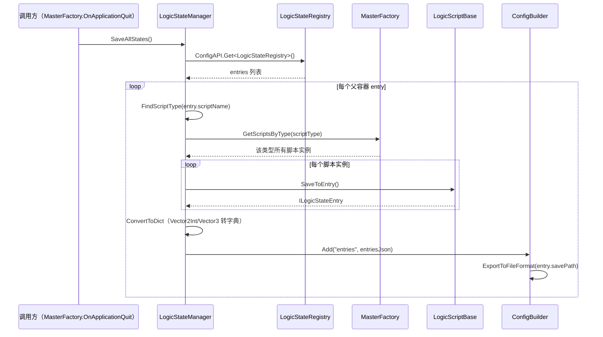
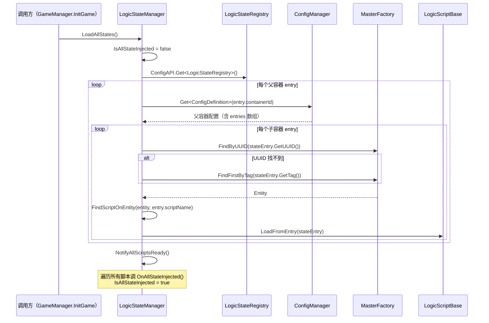

# 第 3 章 逻辑状态系统

> 本章讲逻辑状态系统：**脚本自管数据 + 统一注入 + 两步走**。
> 核心思想：工厂只挂脚本（第一步），状态管理器统一注入数据（第二步），脚本自己拆数据。
>
> 本章用一个贯穿例子——**怪物受击**——讲清楚"实体自管理"：怪物不知道自己的预制体有什么部位，但它的逻辑脚本可以定义配置，配置通过逻辑状态系统注册进来；需要知道自己受击音效时，直接去自己的 Root 容器找。
>
> 配套：《架构优点》A1/B6、《已知问题与待修点》ISSUE-P1-002、NOTE-003/004/010/011。

------

## 3.1 系统定位与职责边界

### 先看一个例子：怪物受击

**场景**：怪物是一个复杂实体，身上有多个身体部位和碰撞体，走流水线第 1 步生成，不加载物理和材质（预制体里在编辑器调好了）。

**问题**：玩家打中怪物的"弱点"部位，怪物怎么知道"弱点"要加倍受伤？

**流程**：

1. **玩家射线**检测到碰撞体 → `EntityMono.FindInParents` 拿到怪物 UUID → 把"受伤部位 = 弱点"存进伤害事件
2. **事件投递**按 UUID 送到怪物的 `受击` 逻辑脚本
3. **怪物拆事件**，看到"弱点"，查**自己内部定义的"部位 → 伤害倍率"表**（弱点 × 2.0），加倍受伤
4. **怪物不知道自己预制体有什么部位**，但它知道自己的逻辑脚本定义了什么配置——配置通过**逻辑状态系统**注册进来

**如果怪物需要知道自己受击音效是什么**：更简单，直接去自己的 `Entity.Root` 容器找，根据逻辑脚本定义的名字找到音效引用。

**核心洞察**：**Root 容器就是实体自己的"全局表"**。实体不查全局表，因为它的所有信息（预制体部位、音效、碰撞体、逻辑脚本配置）都在 Root 下或由逻辑脚本定义。逻辑脚本是"实体对自身信息的解释器"，配置是"实体对自身信息的定义"。

### 负责什么

| 负责                                           | 不负责                           |
| :--------------------------------------------- | :------------------------------- |
| 给逻辑脚本注入配置数据（`LoadFromEntry`）      | 脚本的具体逻辑（上层脚本自己写） |
| 收集脚本状态保存到 JSON（`SaveToEntry`）       | 数据结构的业务含义（脚本自己拆） |
| 全部注入完成后统一回调（`OnAllStateInjected`） | 实体创建（工厂管）               |
| 遍历父容器注册表按 UUID 找实体                 | 事件投递（事件系统管）           |

### 边界

- 逻辑状态系统**只负责传输**，不关心数据结构（"脚本自己拆数据"）
- 一个脚本类型 ↔ 一个父容器（Q21 约束）
- 父容器 `ConfigId` 必须与配置文件名一致（NOTE-003）
- 父容器数组字段必须叫 `entries`（NOTE-004）

------

## 3.2 架构与模块

### 3.2.1 模块清单

| 模块                 | 文件              | 职责                                                         |
| :------------------- | :---------------- | :----------------------------------------------------------- |
| `LogicScriptBase`    | L_001             | 逻辑脚本基类：`LoadFromEntry`/`SaveToEntry`/`OnAllStateInjected` |
| `ILogicStateEntry`   | L_001             | 子容器接口：`GetUUID`/`GetTag`                               |
| `LogicStateManager`  | L_002             | 状态管理器：保存/加载/统一就绪回调                           |
| `LogicStateRegistry` | C_001             | 顶级注册表：父容器 ID ↔ 脚本类名 ↔ 保存路径                  |
| 各父容器配置         | S_003/S_008/S_012 | 实现 `ConfigDefinition` + 内嵌 `ILogicStateEntry`            |

### 3.2.2 两步走

text

```
第一步：工厂挂脚本（第 2 章 LogicFactory）
    │
    ├─ 挂 LogicScriptBase 子类到 LogicObject
    ├─ 注册到 MasterFactory.RegisterScript
    ├─ 注入 Entity（IEntityAware.Entity = entity）
    └─ 事件入口初始化（EventEntryBase.Initialize）

         ↓ 等所有实体建完 ↓

第二步：状态管理器注入数据（本章）
    │
    ├─ 遍历 LogicStateRegistry 的父容器
    ├─ 按 UUID（或 Tag 兜底）找实体
    ├─ 按 scriptName 找脚本
    ├─ 调 script.LoadFromEntry(stateEntry)
    └─ 全部注入完成 → NotifyAllScriptsReady → OnAllStateInjected
```


**为什么两步走**（Q9）：

- 第一步工厂阶段不调逻辑，只挂脚本
- 第二步所有实体建完后统一注入，**保证脚本之间的依赖已就绪**（如 `CharacterInputEntry` 需要 `EventEntryBase` 先挂）
- `OnAllStateInjected` 是"第二步完成"的回调，给需要"读完配置才能初始化"的脚本（如 `CameraRigScript` 找相机、`PlayerTag` 设主角）

### 3.2.3 分层结构

text

```
┌─────────────────────────────────────────────────────────┐
│              LogicStateRegistry（顶级注册表）              │
│  entries: [{ containerId, scriptName, containerType, savePath }] │
└─────────────────────────────────────────────────────────┘
                            │
        ┌───────────────────┼───────────────────┐
        ▼                   ▼                   ▼
┌──────────────┐  ┌──────────────┐  ┌──────────────┐
│ 父容器 1      │  │ 父容器 2      │  │ 父容器 3      │
│ PawnAttackRange│  │ CameraRig    │  │ StateMachine │
│ entries[]    │  │ entries[]    │  │ entries[]    │
└──────────────┘  └──────────────┘  └──────────────┘
        │                   │                   │
        ▼                   ▼                   ▼
┌──────────────┐  ┌──────────────┐  ┌──────────────┐
│ 脚本实例 1    │  │ 脚本实例 2    │  │ 脚本实例 3    │
│ LoadFromEntry│  │ LoadFromEntry│  │ LoadFromEntry│
│ SaveToEntry  │  │ SaveToEntry  │  │ SaveToEntry  │
└──────────────┘  └──────────────┘  └──────────────┘
```


------

## 3.3 核心数据结构

### 3.3.1 `LogicScriptBase`（逻辑脚本基类）

csharp

```c#
public abstract class LogicScriptBase : MonoBehaviour, IEntityAware
{
    public Entity Entity { get; set; }

    // 父容器 ID（子类重写，空串=无状态）
    public abstract string ContainerId { get; }

    // 从容器加载数据（子类重写）
    public abstract void LoadFromEntry(ILogicStateEntry entry);

    // 保存数据到子容器（子类重写）
    public abstract ILogicStateEntry SaveToEntry();

    // 全部数据注入完成后调用（子类按需重写）
    public virtual void OnAllStateInjected() { }
}
```


**三方法职责**：

| 方法                 | 何时调         | 做什么                         |
| :------------------- | :------------- | :----------------------------- |
| `LoadFromEntry`      | 状态加载时     | 从子容器读数据，脚本自己拆     |
| `SaveToEntry`        | 状态保存时     | 打包数据到子容器               |
| `OnAllStateInjected` | 全部注入完成后 | 需要"读完配置才能初始化"的逻辑 |

**`ContainerId` 约定**：

- 空串 = 无状态脚本（如 `PlayerTag`/`ChestInteractScript`/`CharacterAttachmentScript`）
- 非空 = 有状态脚本，值必须与父容器 `ConfigId` 一致（NOTE-003）

### 3.3.2 `ILogicStateEntry`（子容器接口）

csharp

```c#
public interface ILogicStateEntry
{
    string GetUUID();
    string GetTag();
}
```


- 所有父容器内嵌的 `XxxEntry` 实现此接口
- `GetUUID` 用于按 UUID 找实体
- `GetTag` 用于 UUID 找不到时的 Tag 兜底

### 3.3.3 `LogicStateRegistry`（顶级注册表）

csharp

```c#
[Config(configId: "logic_state_registry", priority: 50)]
public class LogicStateRegistry : ConfigDefinition
{
    public LogicStateEntry[] entries;

    public class LogicStateEntry
    {
        public string containerId;      // 父容器配置 ID
        public string scriptName;       // 脚本类名
        public string containerType;    // 父容器类型
        public string savePath;         // 保存路径
    }
}
```


**JSON 示例**：

json

```json
{
  "entries": [
    {
      "containerId": "logic_state_pawn_attack_range",
      "scriptName": "PawnAttackRange",
      "containerType": "PawnAttackRangeStateContainer",
      "savePath": "Assets/Config/ConfigData/logic_state_pawn_attack_range.json"
    },
    {
      "containerId": "entity_state_machine",
      "scriptName": "StateMachineScript",
      "containerType": "StateMachineStateContainer",
      "savePath": "Assets/Config/ConfigData/entity_state_machine.json"
    },
    {
      "containerId": "logic_state_camera_rig",
      "scriptName": "CameraRigScript",
      "containerType": "CameraRigStateContainer",
      "savePath": "Assets/Config/ConfigData/logic_state_camera_rig.json"
    }
  ]
}
```


### 3.3.4 父容器配置（示例：`PawnAttackRangeStateContainer`）

csharp

```c#
[Serializable]
[Config(configId: "logic_state_pawn_attack_range", priority: 100)]
public class PawnAttackRangeStateContainer : ConfigDefinition
{
    public PawnAttackRangeEntry[] entries;  // 字段名必须叫 entries（NOTE-004）

    [Serializable]
    public class PawnAttackRangeEntry : ILogicStateEntry
    {
        public string uuid;
        public string tag;

        public Vector2Int attackRange;
        public Vector2Int attackRange2;
        public int level;
        public float experience;

        public string GetUUID() => uuid;
        public string GetTag() => tag;
    }
}
```


**约定**：

- `ConfigId` 必须与文件名一致（`logic_state_pawn_attack_range` → `logic_state_pawn_attack_range.json`）
- 数组字段必须叫 `entries`
- 内嵌 `XxxEntry` 实现 `ILogicStateEntry`
- 必须有 `uuid` 和 `tag` 字段（接口需要）

------

## 3.4 运行时流程

### 3.4.1 保存流程（`SaveAllStates`）




**代码**（L_002）：

csharp

```c#
public void SaveAllStates()
{
    var registry = ConfigAPI.Get<LogicStateRegistry>();
    foreach (var entry in registry.entries) SaveContainer(entry);
}

private void SaveContainer(LogicStateRegistry.LogicStateEntry entry)
{
    var scriptType = FindScriptType(entry.scriptName);
    var scripts = MasterFactory.Instance.GetScriptsByType(scriptType);

    var entries = new List<object>();
    foreach (var script in scripts)
        if (script is LogicScriptBase logicBase)
            entries.Add(logicBase.SaveToEntry());

    WriteContainerToJson(entry, entries);
}
```


### 3.4.2 加载流程（`LoadAllStates`）




**代码**（L_002）：

csharp

```c#
public void LoadAllStates()
{
    IsAllStateInjected = false;
    var registry = ConfigAPI.Get<LogicStateRegistry>();
    foreach (var entry in registry.entries) LoadContainer(entry);
    NotifyAllScriptsReady();
}

private void LoadContainer(LogicStateRegistry.LogicStateEntry entry)
{
    var containerConfig = ConfigAPI.Get<ConfigDefinition>(entry.containerId);
    var entriesField = containerConfig.GetType().GetField("entries");
    var entriesArray = entriesField.GetValue(containerConfig) as Array;

    foreach (var childEntry in entriesArray)
    {
        if (childEntry is not ILogicStateEntry stateEntry) continue;

        var entity = MasterFactory.Instance.FindByUUID(stateEntry.GetUUID());
        if (entity == null && !string.IsNullOrEmpty(stateEntry.GetTag()))
            entity = MasterFactory.Instance.FindFirstByTag(stateEntry.GetTag());
        if (entity == null) { Debug.LogWarning(...); continue; }

        var script = FindScriptOnEntity(entity, entry.scriptName);
        if (script == null) { Debug.LogWarning(...); continue; }

        script.LoadFromEntry(stateEntry);
    }
}
```


**关键点**：

- **UUID 找不到时 Tag 兜底**（Q20 保护）：存档里有 10 个 pawn，场景只生 5 个，另外 5 个静默跳过
- `ConfigAPI.Get<ConfigDefinition>(containerId)` 用抽象基类做泛型参数，反射拿 `entries` 字段（Q18）
- 找不到实体/脚本只 `LogWarning` 继续，不中断

### 3.4.3 统一就绪回调（`NotifyAllScriptsReady`）

csharp

```c#
private void NotifyAllScriptsReady()
{
    var allScripts = MasterFactory.Instance.GetAllScripts();

    foreach (var s in allScripts)
    {
        try { s.OnAllStateInjected(); }
        catch (Exception e) { Debug.LogError($"[LogicStateManager] {s.name} 就绪回调异常：{e}"); }
    }

    IsAllStateInjected = true;
}
```


**关键点**：

- 遍历**所有**脚本（不只是有状态的），无状态脚本也能收到回调
- `try-catch` 防单个脚本崩掉整体
- `IsAllStateInjected` 标记给需要"等全部注入完成"的脚本用（Q22）

**典型用途**：

| 脚本                        | `OnAllStateInjected` 做什么              |
| :-------------------------- | :--------------------------------------- |
| `PlayerTag`                 | 设主角到 `InputMediator`（主角就绪信号） |
| `CameraRigScript`           | 找相机、设 `ActiveCamera`、锁鼠标        |
| `CharacterAttachmentScript` | 生成枪口挂载点                           |
| `AimLineScript`             | 创建 `LineRenderer`、找枪口              |

------

## 3.5 配置说明

### 3.5.1 加一个父容器配置

**Step 1：写父容器类**

csharp

```c#
[Serializable]
[Config(configId: "logic_state_my_script", priority: 100)]
public class MyScriptStateContainer : ConfigDefinition
{
    public MyScriptEntry[] entries;  // 必须叫 entries

    [Serializable]
    public class MyScriptEntry : ILogicStateEntry
    {
        public string uuid;
        public string tag;

        // 业务字段
        public int level;
        public float experience;

        public string GetUUID() => uuid;
        public string GetTag() => tag;
    }
}
```


**Step 2：写 JSON**（`Assets/Config/ConfigData/logic_state_my_script.json`）

json

```json
{
  "entries": [
    {
      "uuid": "Pawn_0001",
      "tag": "Pawn",
      "level": 5,
      "experience": 100.0
    }
  ]
}
```


**Step 3：注册到 `logic_state_registry`**

json

```json
{
  "entries": [
    {
      "containerId": "logic_state_my_script",
      "scriptName": "MyScript",
      "containerType": "MyScriptStateContainer",
      "savePath": "Assets/Config/ConfigData/logic_state_my_script.json"
    }
  ]
}
```


**Step 4：脚本实现两方法**

csharp

```c#
public class MyScript : LogicScriptBase
{
    public override string ContainerId => "logic_state_my_script";

    public int level;
    public float experience;

    public override void LoadFromEntry(ILogicStateEntry entry)
    {
        if (entry is not MyScriptStateContainer.MyScriptEntry data) return;
        level = data.level;
        experience = data.experience;
    }

    public override ILogicStateEntry SaveToEntry()
    {
        return new MyScriptStateContainer.MyScriptEntry
        {
            uuid = Entity.UUID,
            tag = Entity.Tag,
            level = level,
            experience = experience
        };
    }
}
```


**完成**。不需要改 `LogicStateManager`。

### 3.5.2 命名规范（硬约定）

| 约定                           | 说明                                               | 关联     |
| :----------------------------- | :------------------------------------------------- | :------- |
| 父容器 `ConfigId` = 文件名     | `logic_state_xxx` ↔ `logic_state_xxx.json`         | NOTE-003 |
| 父容器数组字段必须叫 `entries` | `LogicStateManager.LoadContainer` 反射找 `entries` | NOTE-004 |
| 子容器必须有 `uuid`/`tag`      | `ILogicStateEntry` 接口需要                        | —        |
| `scriptName` = 脚本类名        | `FindScriptType` 按类名查                          | —        |
| 一个脚本类型 ↔ 一个父容器      | Q21 约束                                           | —        |

### 3.5.3 保存路径

`savePath` 是**绝对路径**（`Assets/Config/ConfigData/logic_state_xxx.json`），由 `ConfigBuilder.ExportToFileFormat` 写入。

**运行时保存**（`MasterFactory.OnApplicationQuit` → `SaveAllStates`）会覆盖此文件。

------

## 3.6 扩展指南

### 加一个有状态脚本（用怪物例子完整走一遍）

**需求**：怪物受击脚本，定义"部位 → 伤害倍率"表，接收伤害事件时查表加倍。

**Step 1：父容器配置**

csharp

```c#
[Serializable]
[Config(configId: "monster_hit_state", priority: 100)]
public class MonsterHitStateContainer : ConfigDefinition
{
    public MonsterHitEntry[] entries;

    [Serializable]
    public class MonsterHitEntry : ILogicStateEntry
    {
        public string uuid;
        public string tag;

        // 部位 → 伤害倍率
        public List<string> partNames;
        public List<float> partMultipliers;

        public string GetUUID() => uuid;
        public string GetTag() => tag;
    }
}
```


**Step 2：JSON**

json

```json
{
  "entries": [
    {
      "uuid": "Monster_0001",
      "tag": "Monster",
      "partNames": ["弱点", "普通", "护甲"],
      "partMultipliers": [2.0, 1.0, 0.5]
    }
  ]
}
```


**Step 3：注册到 `logic_state_registry`**

json

```json
{
  "containerId": "monster_hit_state",
  "scriptName": "MonsterHitScript",
  "containerType": "MonsterHitStateContainer",
  "savePath": "Assets/Config/ConfigData/monster_hit_state.json"
}
```


**Step 4：脚本**

csharp

```c#
public class MonsterHitScript : LogicScriptBase
{
    public override string ContainerId => "monster_hit_state";

    private Dictionary<string, float> _partMultipliers = new();

    public override void LoadFromEntry(ILogicStateEntry entry)
    {
        if (entry is not MonsterHitStateContainer.MonsterHitEntry data) return;

        _partMultipliers.Clear();
        for (int i = 0; i < data.partNames.Count; i++)
            _partMultipliers[data.partNames[i]] = data.partMultipliers[i];
    }

    public override ILogicStateEntry SaveToEntry()
    {
        var entry = new MonsterHitStateContainer.MonsterHitEntry
        {
            uuid = Entity.UUID,
            tag = Entity.Tag,
            partNames = new List<string>(_partMultipliers.Keys),
            partMultipliers = new List<float>(_partMultipliers.Values)
        };
        return entry;
    }

    // 接收伤害事件（事件系统投递）
    public void OnDamage(string hitPart, float baseDamage)
    {
        float multiplier = _partMultipliers.GetValueOrDefault(hitPart, 1.0f);
        float finalDamage = baseDamage * multiplier;

        // 需要受击音效时，直接去自己的 Root 容器找
        var audio = Entity.Root.GetComponentInChildren<AudioSource>();
        audio?.Play();

        Debug.Log($"[MonsterHit] 部位={hitPart}, 倍率={multiplier}, 最终伤害={finalDamage}");
    }
}
```


**Step 5：怪物蓝图**

json

```json
{
  "blueprintId": "monster",
  "tag": "Monster",
  "modelPath": "TestGameObject/MonsterPrefab",  // 预制体
  "physicsConfigId": "",                        // 留空，预制体自带碰撞体
  "materialId": "",                             // 留空
  "logicScriptIds": ["monster_hit_script"],
  "poolId": "monster_pool"
}
```


**完成**。怪物不知道自己预制体有什么部位，但它的逻辑脚本定义了"部位 → 倍率"配置，配置通过逻辑状态系统注册进来；需要音效时直接去 `Entity.Root` 找。

### 加一个"无状态"脚本

`ContainerId` 返回空串，`LoadFromEntry`/`SaveToEntry` 空实现：

csharp

```c#
public class MyNoStateScript : LogicScriptBase
{
    public override string ContainerId => "";
    public override void LoadFromEntry(ILogicStateEntry entry) { }
    public override ILogicStateEntry SaveToEntry() => null;
}
```


### 加一个"需要读完配置才能初始化"的脚本

重写 `OnAllStateInjected`：

csharp

```c#
public override void OnAllStateInjected()
{
    // 此时所有脚本的 LoadFromEntry 已完成
    // 可以安全地找其他脚本/组件
}
```


------

## 3.7 已知限制与注意事项

| 编号         | 问题                                            | 优先级 |
| :----------- | :---------------------------------------------- | :----- |
| ISSUE-P1-002 | 脚本挂载顺序依赖蓝图数组顺序（隐性依赖）        | P1     |
| ISSUE-P2-005 | `CameraRigScript` 的 `shoulderOffset` 未 Load   | P2     |
| ISSUE-P2-006 | 限时 Buff 时间戳不存盘                          | P2     |
| ISSUE-P2-007 | `StateMachineScript` 枚举 `TryParse` 区分大小写 | P2     |

### 设计约定

- **一个脚本类型 ↔ 一个父容器**（Q21）
- **父容器 `ConfigId` 必须与配置文件名一致**（NOTE-003）
- **父容器数组字段必须叫 `entries`**（NOTE-004）
- **子容器必须有 `uuid`/`tag`**（`ILogicStateEntry` 接口需要）
- **脚本自拆数据**：管理器只负责传输，不关心数据结构
- **两步走**：工厂挂脚本（第一步）→ 状态管理器注入（第二步）
- **`OnAllStateInjected` 是"第二步完成"的回调**，给需要"读完配置才能初始化"的脚本用

### 脚本挂载隐性依赖（ISSUE-P1-002 重点）

**问题**：`LogicFactory` 的 `INeedEventEntry` 注入在 `foreach (logicScriptIds)` 循环内，靠"后续轮次补救"：

- 如果 `CharacterInputEntry` 比 `EventEntryBase` 先挂，第一轮注入失败
- 挂 `EventEntryBase` 时重新遍历 `entity.LogicScripts`，能补上
- 若实体只有 `INeedEventEntry` 没有 `EventEntryBase`，则永远拿不到入口

**规范**：

- `logicScriptIds` 数组里，`EventEntryBase` 子类（如 `TestEntry`）应排在 `INeedEventEntry` 子类（如 `CharacterInputEntry`）**前面**
- 或者实体同时挂两者，靠"后续轮次补救"

**这是全项目唯一的"脚本级隐性依赖"**，其他工厂步骤（物理/渲染/音频）都没有这种问题。

### 隐性依赖

- `LogicStateManager.LoadContainer` 依赖 `MasterFactory.FindByUUID`（实体必须已创建）
- `LogicStateManager.SaveContainer` 依赖 `MasterFactory.GetScriptsByType`（脚本必须已注册）
- `NotifyAllScriptsReady` 的顺序不保证（遍历 `GetAllScripts` 的顺序），`PlayerTag` 设主角和 `CameraRigScript` 找相机的先后不确定（Q61，第一帧可能空转）

------

## 3.8 依赖关系

text

```
LogicStateManager（逻辑状态系统）
    │
    ├─ 依赖：
    │   ├─ ConfigManager（读 logic_state_registry + 父容器配置）
    │   ├─ MasterFactory（FindByUUID / FindFirstByTag / GetScriptsByType）
    │   └─ ConfigBuilder（写 JSON）
    │
    ├─ 被依赖：
    │   ├─ GameManager.InitGame（调 LoadAllStates）
    │   ├─ MasterFactory.OnApplicationQuit（调 SaveAllStates）
    │   └─ 各逻辑脚本（通过 OnAllStateInjected 回调）
    │
    └─ 对外接口：
        LoadAllStates / SaveAllStates / IsAllStateInjected
        ResetStateInjected
```


**被谁依赖**：总控（加载/保存）、逻辑脚本（就绪回调）

**依赖谁**：配置系统、工厂系统

------

**第 3 章结束。**