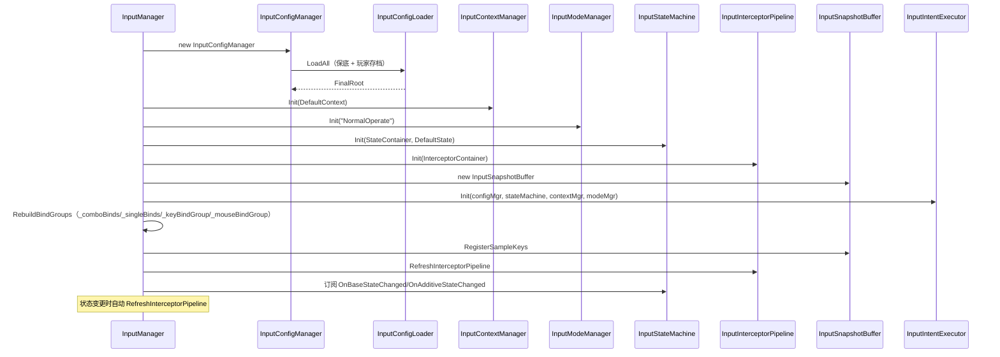
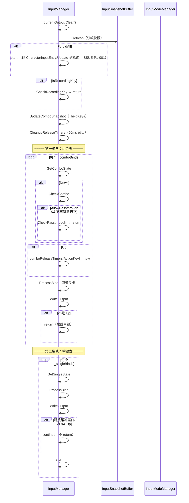
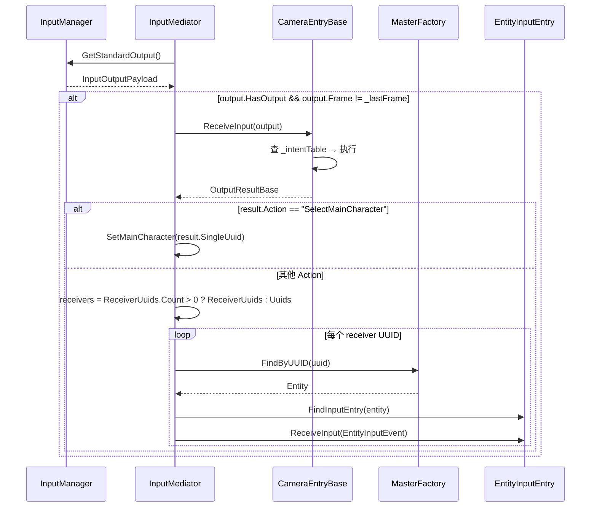

# 第 4 章 输入系统

> 本章讲输入系统：**配置驱动的状态机 + 权威快照双轨 + 范围表达**。
> 核心思想：输入系统只发布"标准化语义"（`InputOutputPayload`），不解释"这意味着什么"；解释权在 `CameraEntryBase` 和 `EntityInputEntry`。
>
> **两套状态哲学**：持续状态（移动/瞄准）用权威快照轮询 `IsActionHeld`，瞬时机（攻击/交互）用事件投递 `InputOutputPayload`。
>
> 配套：《架构优点》B4、《已知问题与待修点》ISSUE-P0-002、ISSUE-P1-001/008、ISSUE-P2-008/009/010/011/013。

------

## 4.1 系统定位与职责边界

### 负责什么

| 负责                                       | 不负责                               |
| :----------------------------------------- | :----------------------------------- |
| 读硬件输入（键盘/鼠标/轴）                 | 解释"这意味着什么"（入口/实体解释）  |
| 双帧快照提供 Down/Hold/Up/None 三态        | 选实体（`CameraEntryBase` 解析范围） |
| 五层解耦（上下文/模式/状态机/拦截器/意图） | 业务逻辑（上层脚本管）               |
| 组合优先 + 单键兜底 + 释放缓冲             | 事件投递（事件系统管）               |
| 标准化输出 `InputOutputPayload`            | 改键 UI（当前简化）                  |
| 保底配置 + 玩家存档                        | 跨系统通信（中转层管）               |

### 边界

- 输入系统**只发布"发生了什么"**（标准化语义），不解释"这意味着什么"
- **持续状态用权威快照轮询**（`IsActionHeld`），**瞬时机用事件投递**（`InputOutputPayload`）
- **`SelectScope` 只表达"选什么范围"**，不选实体；选实体由 `CameraEntryBase.ResolveByScope` 完成
- 输入系统**独立配置体系**（`InputConfigAttribute`），与主配置系统完全平行（C5）

------

## 4.2 架构与模块

### 4.2.1 模块清单

| 模块                       | 文件  | 职责                                               |
| :------------------------- | :---- | :------------------------------------------------- |
| `InputManager`             | I_018 | 主管理器：主循环、组合/单键、CD、改键、输出        |
| `InputConfigManager`       | I_015 | 配置管理：加载/合并/改键/重置/保存                 |
| `InputConfigLoader`        | I_014 | 配置加载：保底（工程目录/Resources）+ 玩家存档     |
| `InputConfigAutoLoader`    | I_011 | 扫描 `InputConfigAttribute` 配置类                 |
| `InputContextManager`      | I_002 | 上下文管理（GameWorld/ShopPanel…）                 |
| `InputModeManager`         | I_005 | 全局模式（ForbidAll/OnlyViewDirect/NormalOperate） |
| `InputStateMachine`        | I_007 | 状态机（Base 互斥 + Additive 叠加）                |
| `InputInterceptorPipeline` | I_004 | 拦截器管道（白/黑名单 AND）                        |
| `InputIntentExecutor`      | I_003 | 意图执行（批量变更上下文/模式/状态）               |
| `InputSnapshotBuffer`      | I_006 | 双帧快照（Down/Hold/Up/None）                      |
| `InputMediator`            | I_024 | 中转层：拉输出 → 给入口 → 转发实体                 |
| `CameraEntryBase`          | I_020 | 摄像机入口基类：范围选择 → UUID                    |
| `CameraEntry_Default`      | I_019 | 默认入口：攻击/交互/移动/选择                      |
| `EntityInputEntry`         | I_022 | 实体输入入口基类：查表执行                         |
| `InputOutputPayload`       | I_012 | 标准化输出                                         |
| `EntityInputEvent`         | I_023 | 中转层组装的实体输入事件                           |
| `OutputResultBase`         | I_021 | 入口返回结果                                       |

### 4.2.2 五层解耦

text

```
┌─────────────────────────────────────────────────────────┐
│ 第 1 层：上下文（Context）                                │
│ GameWorld / ShopPanel / ...                              │
│ 同一按键在不同情境映射不同功能                             │
└─────────────────────────────────────────────────────────┘
                            │
┌─────────────────────────────────────────────────────────┐
│ 第 2 层：模式（Mode）                                     │
│ ForbidAll / OnlyViewDirect / NormalOperate               │
│ 输入系统整体开放程度                                       │
└─────────────────────────────────────────────────────────┘
                            │
┌─────────────────────────────────────────────────────────┐
│ 第 3 层：状态机（StateMachine）                           │
│ Base 互斥（Peace/Battle/Home/CutScene）                   │
│ Additive 叠加（Hit/UIMenu）                               │
│ 状态决定启用哪些拦截层                                     │
└─────────────────────────────────────────────────────────┘
                            │
┌─────────────────────────────────────────────────────────┐
│ 第 4 层：拦截器（Interceptor）                            │
│ 白名单/黑名单，AND 语义，优先级排序                        │
│ 决定具体 Action 能不能过                                   │
└─────────────────────────────────────────────────────────┘
                            │
┌─────────────────────────────────────────────────────────┐
│ 第 5 层：意图（Intent）                                   │
│ EnterBattle / ExitBattle / EnterHit / ...                │
│ 批量变更上下文/模式/状态                                   │
└─────────────────────────────────────────────────────────┘
```


### 4.2.3 两套状态哲学

| 状态类型     | 例子               | 方案         | 代码                                      |
| :----------- | :----------------- | :----------- | :---------------------------------------- |
| **持续状态** | 移动、瞄准         | 权威快照轮询 | `InputManager.IsActionHeld("MoveUp")`     |
| **瞬时机**   | 攻击、交互、测试键 | 事件投递     | `InputOutputPayload` → `EntityInputEvent` |

**为什么这样分**（Q29/Q30/Q31）：

- 持续状态用轮询：不丢帧、不残留、不重复
- 瞬时机用事件：可拦截、可 CD、可精准投递
- **代价**：轮询绕过拦截器（ISSUE-P1-001 `ForbidAll` 下移动未拦）

------

## 4.3 核心数据结构

### 4.3.1 `InputOutputPayload`（标准化输出）

csharp

```c#
public class InputOutputPayload
{
    public bool HasOutput;
    public string ActionKey;        // 配置里的 ActionKey
    public string Action;           // 功能 ID
    public string Context;          // 上下文
    public InputKeyState KeyState;  // Down/Hold/Up/None
    public string Device;           // KeyboardMouse/Mouse
    public int Frame;               // 输出帧号
    public SelectScope Scope;       // 范围定义（完整）
}
```


**关键点**：全是"发生了什么"的客观描述，**没有"这意味着什么"**。解释权在入口/实体。

### 4.3.2 `SelectScope`（范围表达）

csharp

```c#
public class SelectScope
{
    public string ScopeId;
    public string ScopeType;           // Single/Self/Category/ValueRange/Area/Global/Trigger

    // Single
    public string SingleEntityId;
    // Category
    public string CategoryTag;
    public string CategoryMatchMode = "Any";
    // ValueRange
    public string ValueKey;
    public float MinValue = float.MinValue;
    public float MaxValue = float.MaxValue;
    // Area
    public string AreaModelId;
    public float Radius, Height, Length, Width, Angle;
    public SerializableVector3 AreaCenter;
    // 通用
    public bool IncludeSelf = true;
    public string Remark;
}
```


**关键点**：`SelectScope` **只表达"选什么范围"**，不选实体。选实体由 `CameraEntryBase.ResolveByScope` 完成。

### 4.3.3 状态机（`InputStateMachine`）

csharp

```c#
public class InputStateMachine
{
    public string CurrentBaseState { get; private set; }
    private List<string> _additiveStates = new();

    public void SwitchBaseState(string stateName);       // 互斥切换
    public void PushAdditiveState(string stateName);     // 压入附加
    public void PopAdditiveState(string stateName);      // 弹出附加
    public void ClearAdditiveStates();                   // 清空附加
    public List<string> GetActiveInterceptors();         // 当前生效拦截层
}
```


### 4.3.4 拦截器管道（`InputInterceptorPipeline`）

csharp

```c#
public class InputInterceptorPipeline
{
    private Dictionary<string, IInputInterceptor> _allInterceptors;
    private List<IInputInterceptor> _activeInterceptors;

    public void Init(InputInterceptorContainer container);
    public void RefreshActiveInterceptors(List<string> activeIds);
    public bool PassAllCheck(string action, string context, IReadOnlyList<InputStateConfig> activeStates);
}
```


**AND 语义**：多个拦截器同时生效时，**全部通过才放行**。

------

## 4.4 运行时流程

### 4.4.1 初始化（`InputManager.Awake`）




### 4.4.2 每帧主循环（`InputManager.Update`）




### 4.4.3 四道校验关卡（`ProcessBind`）

csharp

```c#
private bool ProcessBind(InputKeyConfig cfg, InputKeyState state)
{
    // 关卡 1：ListenState（Down/Hold/Up 过滤）
    if (!IsStateAllowed(cfg, state)) return false;

    // 关卡 2：Context（AllowContext 列表）
    if (!_contextMgr.IsAllowed(cfg.AllowContext)) return false;

    // 关卡 3：InterceptorPipeline（当前状态启用的拦截器 AND）
    var activeStates = GetActiveStateConfigs();
    if (!_interceptorPipeline.PassAllCheck(cfg.Action, _contextMgr.CurrentContext, activeStates))
        return false;

    // 关卡 4：SelectScopeValidator（范围类型/类别/区域模型）
    var stateCfg = _stateMachine.GetCurrentBaseConfig();
    var scope = ResolveScope(cfg.Scope);
    if (scope == null) return false;
    if (!SelectScopeValidator.IsAllowed(scope, stateCfg, _configMgr.GetAreaModelContainer()))
        return false;

    // 关卡 5：CD（点击冷却/长按间隔）
    if (!CheckCd(cfg, state)) return false;

    return true;
}
```


### 4.4.4 中转层（`InputMediator`）




**关键点**：

- `SelectMainCharacter` 是唯一特殊动作（中转层接住切主角）
- 其他动作**纯中立转发**：看 `ReceiverUuids`（为空则用 `Uuids`）
- `EntityInputEvent` 当前只填 `Action/KeyState/Frame/TargetUuids`（ISSUE-P2-010）

### 4.4.5 摄像机入口（`CameraEntryBase.ResolveByScope`）

csharp

```c#
protected List<GameObject> ResolveByScope(SelectScope scope)
{
    switch (scope.GetScopeType())
    {
        case SelectScopeType.Self:       return ResolveSelf();
        case SelectScopeType.Single:     return ResolveSingle(scope);
        case SelectScopeType.Category:   return ResolveCategory(scope);
        case SelectScopeType.ValueRange: return ResolveValueRange(scope);
        case SelectScopeType.Area:       return ResolveArea(scope);
        case SelectScopeType.Global:     return ResolveGlobal();
        case SelectScopeType.Trigger:    return ResolveTrigger(scope);
        default: return new List<GameObject>();
    }
}
```


**7 种范围**：

| 类型         | 解析方式                                          |
| :----------- | :------------------------------------------------ |
| `Self`       | 主角自己                                          |
| `Single`     | 射线打中的单个实体                                |
| `Category`   | 射线打中的实体的 Tag 下所有实体                   |
| `ValueRange` | 全图实体中蓝图字段值在范围内的                    |
| `Area`       | 以射线锚点为中心，Sphere/Box/Cylinder/Cone 形状内 |
| `Global`     | 全图所有实体                                      |
| `Trigger`    | 主角周围 `Radius` 内实现了 `IInteractable` 的实体 |

### 4.4.6 实体入口（`EntityInputEntry`）

csharp

```c#
public abstract class EntityInputEntry : LogicScriptBase
{
    private Dictionary<string, Action<EntityInputEvent>> _inputTable = new();

    protected abstract void RegisterInputs();

    protected void RegisterInput(string action, Action<EntityInputEvent> handler)
    {
        _inputTable[action] = handler;
    }

    public void ReceiveInput(EntityInputEvent evt)
    {
        if (_inputTable.TryGetValue(evt.Action, out var handler))
            handler.Invoke(evt);
    }
}
```


**方法注册**（A3）：只处理注册过的 Action，未注册的不执行。

------

## 4.5 配置说明

### 4.5.1 配置清单（7 个）

| configId             | 优先级 | 用途                                           |
| :------------------- | :----- | :--------------------------------------------- |
| `input_global`       | 50     | 全局配置（默认 CD/上下文/状态/设备/DebugMode） |
| `input_binds`        | 100    | 按键绑定                                       |
| `input_interceptors` | 150    | 拦截器配置                                     |
| `input_states`       | 200    | 状态机配置                                     |
| `input_intents`      | 300    | 意图配置                                       |
| `input_scopes`       | 125    | 范围配置                                       |
| `input_area_models`  | 55     | 区域模型配置                                   |

### 4.5.2 按键绑定（`input_binds`）

json

```json
{
  "Items": [
    {
      "ActionKey": "MoveUp",
      "IsCombo": false,
      "Key1": "W",
      "AltKey1": "UpArrow",
      "Action": "MoveUp",
      "AllowContext": ["GameWorld"],
      "ListenState": ["Down", "Hold", "Up"],
      "HoldInterval": 0.05,
      "Scope": "Self"
    },
    {
      "ActionKey": "Attack",
      "IsCombo": false,
      "MouseButtonIndex": 0,
      "Action": "Attack",
      "AllowContext": ["GameWorld"],
      "ListenState": ["Down", "Hold"],
      "ClickCdThreshold": 0.3,
      "Scope": "Single"
    }
  ]
}
```


### 4.5.3 状态机（`input_states`）

json

```json
{
  "Items": [
    {
      "StateName": "Peace",
      "StateType": "Base",
      "InterceptorList": ["Global"],
      "MergeMode": "And",
      "ClearAdditiveOnBaseSwitch": true,
      "IsEnable": true,
      "AllowScopeTypes": ["Single", "Category", "Area", "Global", "Self", "Trigger"],
      "AllowCategories": ["Pickable", "NPC", "Door"],
      "AllowAreaModelIds": ["Sphere", "Box"]  // 必须与 input_area_models 的 ModelId 一致（ISSUE-P0-002）
    },
    {
      "StateName": "Hit",
      "StateType": "Additive",
      "InterceptorList": ["HitLimit"],
      "MergeMode": "And",
      "ClearAdditiveOnBaseSwitch": true,
      "IsEnable": true
    }
  ]
}
```


### 4.5.4 拦截器（`input_interceptors`）

json

```json
{
  "Items": [
    {
      "Id": "Global",
      "InterceptorMode": "BlackList",
      "Priority": 0,
      "BlockActions": ["OpenDebugPanel"],
      "IsEnable": true
    },
    {
      "Id": "PeaceLimit",
      "InterceptorMode": "BlackList",
      "Priority": 10,
      "BlockActions": ["Attack"],
      "IsEnable": true
    }
  ]
}
```


### 4.5.5 意图（`input_intents`）

json

```json
{
  "Items": [
    {
      "IntentName": "EnterBattle",
      "TargetContext": "GameWorld",
      "TargetBaseState": "Battle",
      "Order": 0,
      "IsEnable": true
    },
    {
      "IntentName": "EnterHit",
      "PushAdditiveStates": ["Hit"],
      "Order": 0,
      "IsEnable": true
    }
  ]
}
```


### 4.5.6 范围（`input_scopes`）

json

```json
{
  "Items": [
    { "ScopeId": "Self", "ScopeType": "Self" },
    { "ScopeId": "Single", "ScopeType": "Single" },
    {
      "ScopeId": "Area_Sphere_3",
      "ScopeType": "Area",
      "AreaModelId": "Sphere",
      "Radius": 3.0
    }
  ]
}
```


### 4.5.7 区域模型（`input_area_models`）

json

```json
{
  "Items": [
    { "ModelId": "Sphere", "AreaShape": "Sphere", "ParamSchema": "radius" },
    { "ModelId": "Box", "AreaShape": "Box", "ParamSchema": "length,height,width" },
    { "ModelId": "Cylinder", "AreaShape": "Cylinder", "ParamSchema": "radius,height" },
    { "ModelId": "Cone", "AreaShape": "Cone", "ParamSchema": "angle,radius" }
  ]
}
```


### 4.5.8 配置依赖关系（跨文件）

text

```
input_states.AllowAreaModelIds
    ↓ 必须引用
input_area_models.ModelId

input_states.InterceptorList
    ↓ 必须引用
input_interceptors.Id

input_binds.Scope
    ↓ 必须引用
input_scopes.ScopeId

input_intents.TargetBaseState / PushAdditiveStates / PopAdditiveStates
    ↓ 必须引用
input_states.StateName

input_binds.AllowContext
    ↓ 必须引用
（代码里硬编码的上下文名：GameWorld/ShopPanel...）
```


> ⚠️ **ISSUE-P0-002**：`input_states` 的 `AllowAreaModelIds` 当前写的是 `SphereRadius`/`BoxSize`，与 `input_area_models` 的 `Sphere`/`Box` 不一致，导致 Area 范围被拦。

------

## 4.6 扩展指南

### 加一个按键

1. `input_binds.json` 加一条 `InputKeyConfig`
2. `Action` 设为目标功能 ID
3. `Scope` 引用 `input_scopes` 的 `ScopeId`
4. `AllowContext` 引用上下文名
5. 在 `CameraEntry_Default.RegisterIntents` 或 `EntityInputEntry.RegisterInputs` 里注册处理方法

### 加一个状态

1. `input_states.json` 加一条 `InputStateConfig`
2. `StateType` 设 `Base` 或 `Additive`
3. `InterceptorList` 引用 `input_interceptors.Id`
4. `AllowScopeTypes`/`AllowCategories`/`AllowAreaModelIds` 设范围限制

### 加一个拦截器

1. `input_interceptors.json` 加一条
2. `InterceptorMode` 设 `WhiteList` 或 `BlackList`
3. `AllowActions`/`BlockActions` 填 Action 列表
4. 在 `input_states.json` 的 `InterceptorList` 里引用

### 加一个意图

1. `input_intents.json` 加一条 `InputIntentConfig`
2. `IntentName` 是外部调用名
3. `TargetContext`/`TargetBaseState`/`PushAdditiveStates`/`PopAdditiveStates` 设变更
4. 外部调 `InputManager.Instance.ApplyIntent("EnterBattle")`

### 加一个摄像机入口

csharp

```c#
public class MyCameraEntry : CameraEntryBase
{
    protected override void RegisterIntents()
    {
        RegisterIntent("Attack", OnAttack);
        RegisterIntent("Interact", OnInteract);
    }

    private void OnAttack(InputOutputPayload output)
    {
        var entities = ResolveByScope(output.Scope);
        var uuids = ToUuids(entities);
        _result.HasResult = true;
        _result.Action = output.Action;
        _result.Uuids = uuids;
        _result.ReceiverUuids.Add(_mainCharacterUuid);
        _result.Frame = output.Frame;
    }
}
```


### 加一个实体输入行为

csharp

```c#
public class MyEntityInputEntry : EntityInputEntry
{
    protected override void RegisterInputs()
    {
        RegisterInput("Attack", OnAttack);
        RegisterInput("Interact", OnInteract);
    }

    private void OnAttack(EntityInputEvent e)
    {
        if (e.KeyState != InputKeyState.Down) return;
        // 业务逻辑
    }
}
```


### 加一个改键（当前简化）

csharp

```c#
InputManager.Instance.StartRecordKey("MoveUp", key => {
    Debug.Log($"改键为：{key}");
    InputManager.Instance.SaveModify();
});
```


⚠️ 当前只改 `Key1` 不改 `AltKey1`（ISSUE-P2-021）。

------

## 4.7 已知限制与注意事项

| 编号         | 问题                                                  | 优先级 |
| :----------- | :---------------------------------------------------- | :----- |
| ISSUE-P0-002 | `AllowAreaModelIds` 与 `input_area_models` 命名不一致 | P0     |
| ISSUE-P1-001 | `ForbidAll` 下 `CharacterInputEntry` 仍可移动         | P1     |
| ISSUE-P1-008 | 输入配置打包导出未自动化                              | P1     |
| ISSUE-P2-008 | `InputConfigAutoLoader` 只扫当前程序集                | P2     |
| ISSUE-P2-009 | `WriteOutput` 里冗余 Clear                            | P2     |
| ISSUE-P2-010 | `EntityInputEvent` 字段未填全                         | P2     |
| ISSUE-P2-011 | `CameraEntry_Default.OnSelect` 是旧测试代码           | P2     |
| ISSUE-P2-013 | 摄像机绕过输入系统直接读 Unity Input                  | P2     |
| ISSUE-P2-021 | 改键/存档上限未迭代                                   | P2     |

### 设计约定

- **输入系统只发布标准化语义**：`InputOutputPayload` 不含"这意味着什么"
- **解释权在入口/实体**：`CameraEntryBase.RegisterIntent` / `EntityInputEntry.RegisterInput` 查表
- **两套状态哲学**：持续状态轮询 `IsActionHeld`，瞬时机事件投递
- **`SelectScope` 只表达范围，不选实体**
- **组合优先 + 单键兜底 + 50ms 释放缓冲**
- **`AllowPassthrough` 第三键穿透**
- **改键只改 `Key1`**（当前简化）
- **`UUID`/`UUIDS` 大写**（事件系统规范，见第 5 章）

### 隐性依赖

- **跨文件配置依赖**：`input_states.AllowAreaModelIds` → `input_area_models.ModelId`；`input_states.InterceptorList` → `input_interceptors.Id`；`input_binds.Scope` → `input_scopes.ScopeId`
- **`CameraRigScript.ActiveCamera`**：`CharacterInputEntry.Update` 读它做相机相对移动，为 null 时降级用 `localInput`（Q62）
- **`PlayerTag.OnAllStateInjected`**：设主角到 `InputMediator`，主角就绪信号（Q33）
- **`InputMediator.Start`**：自动找 `CameraEntry_Default`（场景预挂，Q61）

### 未完成/待补

- 改键完整化（FEAT-003）
- 打包导出自动化（FEAT-002）
- 输入系统"两套状态"统一（FEAT-008）
- 摄像机接入输入系统（ISSUE-P2-013 待改）

------

## 4.8 依赖关系

text

```
InputManager（输入系统）
    │
    ├─ 依赖：
    │   ├─ InputConfigManager（读配置）
    │   ├─ InputContextManager/ModeManager/StateMachine/InterceptorPipeline
    │   ├─ InputSnapshotBuffer（双帧快照）
    │   └─ InputIntentExecutor（意图执行）
    │
    ├─ 被依赖：
    │   ├─ InputMediator（拉 GetStandardOutput）
    │   ├─ CharacterInputEntry（IsActionHeld 轮询）
    │   └─ CameraRigScript（未接入，直接用 Unity Input，ISSUE-P2-013）
    │
    └─ 对外接口：
        GetStandardOutput / ApplyIntent / IsActionHeld
        IsKeyHeldByString / StartRecordKey / SaveModify / ReloadConfig
```


**被谁依赖**：中转层、上层脚本（移动/相机）

**依赖谁**：独立配置体系（`InputConfigManager`），不依赖主配置系统

**平行体系**：主配置系统（`ConfigManager`）和输入配置系统（`InputConfigLoader`）**完全独立**（C5）

------

**第 4 章结束。**