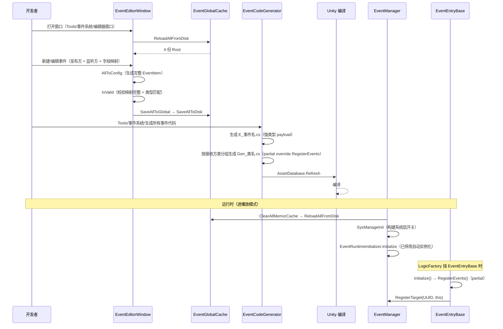
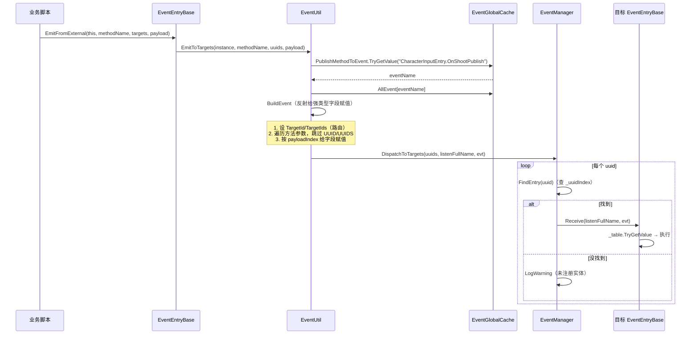
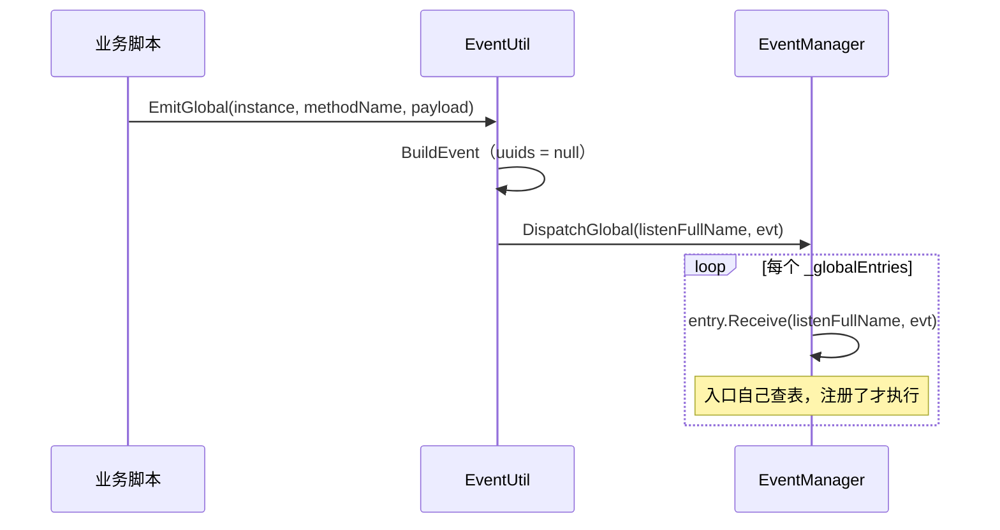

# 第 5 章 事件系统

> 本章讲事件系统：**编辑器驱动 + 代码生成 + UUID 投递 + 全局广播**。
> 核心思想：事件是"显式信息"，发布方定义 payload，通道只路由，监听方自己解释。加一个事件 = 编辑器配 + 一键生成 + 编译即用。
>
> **编辑器是系统的一部分**（C3）：`EventEditorWindow` + `EventCodeGenerator` 不是辅助工具，是核心组件。配置、代码生成、方法扫描、映射校验都在编辑器完成，运行时只做"读配置 + 反射调用"。
>
> 配套：《架构优点》B5、《已知问题与待修点》ISSUE-P0-001、ISSUE-P1-004/005、ISSUE-P2-014/015/016/017/018/023/024。

------

## 5.1 系统定位与职责边界

### 负责什么

| 负责                                          | 不负责                                |
| :-------------------------------------------- | :------------------------------------ |
| 编辑器配置事件（发布方/监听方/字段映射）      | 事件的业务含义（监听方自己解释）      |
| 一键生成强类型事件类 + partial 绑定           | 事件投递到哪（UUID 路由由发布方定）   |
| 扫描 `[EventPublishAttr]`/`[EventListenAttr]` | 事件的执行顺序（队列协程独立）        |
| 按 UUID 精准投递 / 全局广播                   | 事件内容（发布方打包）                |
| 系统层开关（CanPublish/CanListen）            | 自定义类型序列化细节（Newtonsoft 管） |

### 边界

- **事件是"显式信息"**：payload 字段可见、可配映射，监听方自己解释
- **通道只路由，不解释**：`EventManager` 只做"按 UUID 找入口 / 遍历全局入口"，不碰事件内容
- **发布方唯一**：一个事件只有一个发布方法（Q49）
- **监听方自解释**：`EventEntryBase.Receive` 查 `_table` 命中才执行
- **编辑器是系统的一部分**：配置、代码生成、映射校验都在编辑器完成

------

## 5.2 架构与模块

### 5.2.1 模块清单

| 模块                      | 文件  | 层级     | 职责                                         |
| :------------------------ | :---- | :------- | :------------------------------------------- |
| `EventEditorWindow`       | E_012 | 编辑器层 | 4 Tab 配置界面                               |
| `EventCodeGenerator`      | E_013 | 编辑器层 | 生成事件类 + partial 绑定                    |
| `EventConfigEditorHelper` | E_014 | 编辑器层 | 节流刷新 AssetDatabase                       |
| `EventConfigHelper`       | E_003 | 配置层   | 读写 4 个 JSON（Newtonsoft）                 |
| `EventGlobalCache`        | E_001 | 配置层   | 全局缓存（4 份 Root + 方法参数）             |
| `EventReflectTool`        | E_004 | 反射层   | 扫 `[EventPublishAttr]`/`[EventListenAttr]`  |
| `EventSystemManager`      | E_011 | 系统层   | 系统开关（CanPublish/CanListen）             |
| `EventManager`            | E_007 | 运行时层 | 6 条队列 + 强类型订阅 + UUID 寻址 + 全局广播 |
| `EventUtil`               | E_009 | 运行时层 | 发布/投递/打包/解包                          |
| `EventEntryBase`          | E_005 | 入口层   | partial 生成 RegisterEvents + Receive 查表   |
| `EventRuntimeInitializer` | E_008 | 初始化层 | 已停用自动实例化（业务交工厂）               |
| `Package`                 | E_010 | 数据     | 弱类型包                                     |
| `PackageEvent`            | E_002 | 数据     | 事件基类                                     |

### 5.2.2 三层架构

text

```
┌─────────────────────────────────────────────────────────┐
│ 编辑器层（Editor Only）                                   │
│ EventEditorWindow / EventCodeGenerator / EditorHelper    │
│ 配置、代码生成、映射校验                                   │
└─────────────────────────────────────────────────────────┘
                            │ 生成
                            ▼
┌─────────────────────────────────────────────────────────┐
│ 配置层（JSON）                                            │
│ SysIdConfig / EventConfig / LogConfig / VersionConfig    │
│ + 生成的 E_事件名.cs / Gen_类名.cs                        │
└─────────────────────────────────────────────────────────┘
                            │ 加载
                            ▼
┌─────────────────────────────────────────────────────────┐
│ 运行时层                                                  │
│ EventManager（6 队列 + UUID 寻址 + 全局广播）             │
│ EventUtil（发布/投递/打包/解包）                          │
│ EventEntryBase（Receive 查表）                           │
└─────────────────────────────────────────────────────────┘
```


### 5.2.3 双轨投递

| 模式          | 入口                                                  | 适用                    |
| :------------ | :---------------------------------------------------- | :---------------------- |
| UUID 定点投递 | `EmitToTargets(instance, methodName, uuids, payload)` | 攻击命中、交互目标      |
| 全局广播      | `EmitGlobal(instance, methodName, payload)`           | 系统级通知（UI 刷新等） |

### 5.2.4 6 条队列

| 队列    | 协程间隔                    | 用途     |
| :------ | :-------------------------- | :------- |
| Logic   | `yield return null`（每帧） | 逻辑事件 |
| Render  | `WaitForSeconds(0.016f)`    | 渲染事件 |
| Physics | `WaitForSeconds(0.01f)`     | 物理事件 |
| Audio   | `WaitForSeconds(0.033f)`    | 音频事件 |
| Input   | `yield return null`（每帧） | 输入事件 |
| Network | `yield return null`（每帧） | 网络事件 |

------

## 5.3 核心数据结构

### 5.3.1 `PackageEvent`（事件基类）

csharp

```c#
public abstract class PackageEvent
{
    public string EventClassFullName;   // 代码内部定义的事件名（如 "E_TEST_001"）
    public EventQueueType QueueType;    // 所属队列
    public Package Package = new();     // 弱类型包
}
```


### 5.3.2 `Package`（弱类型包）

csharp

```c#
public class Package
{
    public Dictionary<string, object> data = new();
    public List<string> KeyList = new();

    public void Put(string key, object content);
    public bool Get<T>(string key, out T result);
    public T GetSafe<T>(string key, T defaultValue = default);
    public bool Has(string key);
    public bool ValidateAll();
    public bool ValidateFields(params string[] keys);
}
```


### 5.3.3 `EventItem`（事件配置）

csharp

```c#
public class EventItem
{
    public string EventName;                                    // 事件名（如 "TEST_001"）
    public string EventClassFullName;                           // 生成类名（如 "E_TEST_001"）
    public EventQueueType QueueType;
    public bool GlobalEnable;

    // 发布方
    public string EventPublish;                                 // "TestEntry.TestEventPublish"
    public List<string> PublishSysId;
    public Dictionary<string, string> PublishMethodToSystemID;

    // 监听方
    public List<string> EventListen;                            // ["TestEntry.TestEventListen"]
    public List<string> ListenSysId;
    public Dictionary<string, string> ListenMethodToSystemID;

    // 字段映射
    public Dictionary<string, List<string>> PublishKey;         // 方法 → 包 KEY 列表
    public Dictionary<string, List<string>> ListenKey;
    public Dictionary<string, Dictionary<string, string>> KeyConnection;  // 发布参数名 → 监听参数名
}
```


### 5.3.4 `EventEntryBase`（入口基类）

csharp

```c#
public abstract class EventEntryBase : LogicScriptBase
{
    private readonly Dictionary<string, Action<PackageEvent>> _table = new();
    public override string ContainerId => "event";

    public void Initialize()
    {
        RegisterEvents();  // partial 生成
        if (Entity != null && !string.IsNullOrEmpty(Entity.UUID))
            EventManager.Instance?.RegisterTarget(Entity.UUID, this);
    }

    public void Shutdown()
    {
        if (Entity != null && !string.IsNullOrEmpty(Entity.UUID))
            EventManager.Instance?.UnregisterTarget(Entity.UUID);
    }

    protected virtual void RegisterEvents() { }  // partial 生成 override

    protected void RegisterMethod(string methodName, Action<PackageEvent> handler)
    {
        _table[$"{GetType().Name}.{methodName}"] = handler;
    }

    public void Receive(string key, PackageEvent evt)
    {
        if (_table.TryGetValue(key, out var handler))
            handler.Invoke(evt);
    }
}
```


### 5.3.5 `INeedEventEntry`（事件入口注入接口）

csharp

```c#
public interface INeedEventEntry
{
    EventEntryBase EventEntry { get; set; }
}
```


由 `LogicFactory` 在挂载完成后注入（见第 2 章 2.4.3）。

------

## 5.4 运行时流程

### 5.4.1 编辑器配置 → 代码生成 → 编译 → 运行时注册




### 5.4.2 发布事件（UUID 定点投递）

csharp

```c#
// 业务代码
EventEntry.EmitFromExternal(this, nameof(OnShootPublish), e.TargetUuids, 10f);
```




### 5.4.3 发布事件（全局广播）

csharp

```c#
EventUtil.EmitGlobal(this, nameof(SomePublishMethod), payload);
```




### 5.4.4 强类型事件类生成（`E_事件名.cs`）

csharp

```c#
public class E_TEST_001 : PackageEvent
{
    public string TargetId;             // 路由（单投）
    public List<string> TargetIds;      // 路由（多投）

    public int value;                   // 来自发布方法参数 value
    public string msg;                  // 来自发布方法参数 msg

    public E_TEST_001()
    {
        EventClassFullName = "E_TEST_001";
        QueueType = EventQueueType.Logic;
    }
}
```


**生成规则**：

- 路由字段 `TargetId`/`TargetIds` 固定生成
- payload 字段来自发布方法参数，**跳过 `UUID`/`UUIDS`**（大小写敏感，ISSUE-P2-014）
- 构造函数设 `EventClassFullName` + `QueueType`

### 5.4.5 partial 绑定生成（`Gen_类名.cs`）

csharp

```c#
public partial class TestEntry
{
    protected override void RegisterEvents()
    {
        RegisterMethod("TestEventListen", evt =>
            TestEventListen(((E_TEST_001)evt).value, ((E_TEST_001)evt).msg));
        RegisterMethod("TestInputToListen", evt =>
            TestInputToListen(((E_TEST_002)evt).vle, ((E_TEST_002)evt).name));
    }
}
```


**生成规则**：

- 按接收方类名分组，一个类一个文件
- `RegisterMethod(methodName, evt => 方法名(字段...))`
- 字段名按 `KeyConnection` 映射（`value` → `vle`），无映射用同名字段

------

## 5.5 配置说明

### 5.5.1 配置清单（4 个 JSON）

| 文件                    | 类                  | 用途                                    |
| :---------------------- | :------------------ | :-------------------------------------- |
| `SysIdConfig.json`      | `SysIdConfigRoot`   | 系统 ID 列表 + 事件开关                 |
| `EventConfig.json`      | `EventConfigRoot`   | 事件配置（EventItem 字典 + 方法实例表） |
| `OperateLogConfig.json` | `LogConfigRoot`     | 操作日志                                |
| `VersionConfig.json`    | `VersionConfigRoot` | 版本记录（预留未使用，ISSUE-P2-018）    |

**路径**：`Assets/Resources/EventConfig/`

### 5.5.2 事件配置（`EventConfig.json`）

json

```json
{
  "Items": {
    "TEST_001": {
      "EventName": "TEST_001",
      "EventClassFullName": "E_TEST_001",
      "QueueType": 0,
      "GlobalEnable": true,
      "EventPublish": "TestEntry.TestEventPublish",
      "EventListen": ["TestEntry.TestEventListen"],
      "PublishSysId": ["TEST"],
      "ListenSysId": ["TEST"],
      "PublishKey": {
        "TestEntry.TestEventPublish": ["UUIDS", "value", "msg"]
      },
      "ListenKey": {
        "TestEntry.TestEventListen": ["value", "msg"]
      },
      "KeyConnection": {
        "TestEntry.TestEventPublish_TestEntry.TestEventListen": {
          "value": "value",
          "msg": "msg"
        }
      }
    }
  }
}
```


**关键字段**：

- `PublishKey`：发布方法的参数列表（含 `UUIDS` 路由）
- `ListenKey`：监听方法的参数列表
- `KeyConnection`：映射 key = `$"{发布方}_{监听方}"`，value = `{监听参数名 → 发布参数名}`

### 5.5.3 系统 ID 配置（`SysIdConfig.json`）

json

```json
{
  "ItemsIsEnable": {
    "TEST": {
      "SysId": "TEST",
      "PublishEvent": { "E_TEST_001": true },
      "ListenEvent": { "E_TEST_001": true }
    }
  },
  "ItemsNoEnable": {},
  "SysIDToPublsihMethod": {
    "TEST": ["TestEntry.TestEventPublish"]
  },
  "SysIDToListenMethod": {
    "TEST": ["TestEntry.TestEventListen"]
  }
}
```


------

## 5.6 扩展指南

### 加一个事件（完整流程）

**Step 1：写发布方法 + 监听方法**

csharp

```c#
// 发布方
public class MyPublisher : EventEntryBase
{
    [EventPublishAttr]
    public void MyPublish(List<string> UUIDS, int damage, string targetName) { }

    public void DoPublish()
    {
        EmitFromExternal(this, nameof(MyPublish), new List<string> { "Pawn_0001" }, 10, "敌人");
    }
}

// 监听方
public class MyListener : EventEntryBase
{
    [EventListenAttr]
    public void MyListen(int dmg, string name)
    {
        Debug.Log($"收到伤害：{dmg}，目标：{name}");
    }
}
```


**Step 2：编辑器配置**

1. 打开 `Tools/事件系统/编辑器窗口`
2. 系统 ID 管理：新建 `TEST_SYS`
3. 方法绑定：把 `MyPublisher.MyPublish` 和 `MyListener.MyListen` 绑到 `TEST_SYS`
4. 事件总览：新建事件 `MY_EVENT`
5. 编辑：选发布方 `MyPublisher.MyPublish`，监听方 `MyListener.MyListen`
6. 字段映射：`dmg → damage`，`name → targetName`
7. 保存

**Step 3：生成代码**

`Tools/事件系统/生成所有事件代码` → 生成 `E_MY_EVENT.cs` + `Gen_MyListener.cs`

**Step 4：编译即用**

编译后，运行时 `MyPublisher.DoPublish` → `MyListener.MyListen(10, "敌人")`。

### 加一个自定义类型 payload

csharp

```c#
[Serializable]
public class Event_Class_Test_001
{
    public string TestName;
}

// 发布
[EventPublishAttr]
public void Test_Class_Event_002(List<string> UUIDS, Event_Class_Test_001 evt) { }

// 监听
[EventListenAttr]
public void Test_Class_Event_002(Event_Class_Test_001 evt) { }
```


`TypeNameHandling.All` 支持自定义类型跨事件传递（S_005/S_006 验证）。

### 加一个系统 ID

1. 编辑器 `系统ID管理` Tab
2. 新建系统 ID + 备注
3. 绑定发布/监听方法
4. `SysIdConfig.json` 自动更新

### 加一个队列

当前 6 条队列固定（Logic/Render/Physics/Audio/Input/Network）。加新队列需要改 `EventQueueType` 枚举 + `EventManager` 加队列 + 协程 + `EventUtil.EmitEvent` switch 分支。

------

## 5.7 怪物受击事件例子（贯穿第 3 章）

**发布方**：玩家攻击脚本

csharp

```c#
[EventPublishAttr]
public void OnShootPublish(List<string> Uuids, string hitPart, float damage) { }

private void HandleAttackResult(EntityInputEvent e)
{
    if (e.TargetUuids.Count == 0) return;
    // 假设射线检测到部位名 "弱点"
    EventEntry.EmitFromExternal(this, nameof(OnShootPublish),
        e.TargetUuids, "弱点", 10f);
}
```


**监听方**：怪物受击脚本（第 3 章例子）

csharp

```c#
public class MonsterHitScript : LogicScriptBase
{
    private Dictionary<string, float> _partMultipliers = new();

    public override string ContainerId => "monster_hit_state";

    public override void LoadFromEntry(ILogicStateEntry entry)
    {
        // 从父容器读"部位 → 倍率"配置
    }

    [EventListenAttr]
    public void OnShootListen(string hitPart, float damage)
    {
        float multiplier = _partMultipliers.GetValueOrDefault(hitPart, 1.0f);
        float finalDamage = damage * multiplier;
        Debug.Log($"部位={hitPart}, 倍率={multiplier}, 最终伤害={finalDamage}");
    }
}
```


**链路**：

1. 玩家攻击 → `InputManager` 输出 `Attack`
2. `InputMediator` → `CameraEntry_Default.OnAttack` → 射线检测 → `hitPart = "弱点"` → `_result.ReceiverUuids.Add(主角UUID)`
3. `CharacterInputEntry.HandleAttackResult` → `EventEntry.EmitFromExternal(OnShootPublish, 目标UUID, "弱点", 10f)`
4. `EventManager.DispatchToTargets` → 怪物 `EventEntryBase.Receive("MonsterHitScript.OnShootListen", evt)`
5. `MonsterHitScript.OnShootListen` → 查 `_partMultipliers["弱点"] = 2.0` → 最终伤害 20

**关键点**：怪物**不知道自己的预制体有什么部位**，但它的逻辑脚本定义了"部位 → 倍率"配置（第 3 章逻辑状态系统注册）；事件只把"弱点"这个**信息**送到怪物面前，怪物**自己解释**。

------

## 5.8 已知限制与注意事项

| 编号         | 问题                                                      | 优先级 |
| :----------- | :-------------------------------------------------------- | :----- |
| ISSUE-P0-001 | 事件配置打包后 `File.ReadAllText` 失效                    | P0     |
| ISSUE-P1-004 | `CanPublish` 缓存用实例做 key 永不命中                    | P1     |
| ISSUE-P1-005 | `BuildArgList` 对"不使用"映射仍生成代码                   | P1     |
| ISSUE-P2-014 | `BuildEvent` payloadIndex 大小写敏感                      | P2     |
| ISSUE-P2-015 | `RegisterMethod` key 依赖 `GetType().Name`                | P2     |
| ISSUE-P2-016 | `DrawPublishSelector` KeyConnection key 不一致            | P2     |
| ISSUE-P2-017 | `EventRuntimeInitializer._initialized` Domain Reload 残留 | P2     |
| ISSUE-P2-018 | `VersionConfigRoot` 有定义无写入                          | P2     |
| ISSUE-P2-023 | `DispatchTypedToEntry` 过渡代码无人调                     | P2     |
| ISSUE-P2-024 | `CanListen` 未接入                                        | P2     |

### 设计约定

- **事件是显式信息**：payload 字段可见、可配映射
- **通道只路由，不解释**：`EventManager` 不碰事件内容
- **发布方唯一**：一个事件只有一个发布方法（Q49）
- **监听方自解释**：`EventEntryBase.Receive` 查表命中才执行
- **`UUID`/`UUIDS` 大写**：`BuildEvent` 大小写敏感（ISSUE-P2-014）
- **类名全局唯一**：`RegisterMethod` 用 `GetType().Name`，全项目不用命名空间（Q45）
- **监听走 partial 注册，发布走反射扫描**（Q49）
- **编辑器是系统的一部分**：配置、代码生成、映射校验都在编辑器

### 隐性依赖

- **`LogicFactory` 挂 `EventEntryBase` 时调 `RegisterTarget`**：依赖 `EventManager` 已创建（`GameManager` 顺序）
- **`INeedEventEntry` 注入依赖 `EventEntryBase` 已挂**（ISSUE-P1-002）
- **`EmitToTargets` 依赖 `PublishMethodToEvent` 有配置**：未配事件的方法静默不投递（Q48）
- **`BuildEvent` 的 payloadIndex 严格匹配**：调用方传参数量必须与方法参数数量一致（除 UUID），否则静默失败（Q47）

### 未完成/待补

- 打包后配置读取（FEAT-002，ISSUE-P0-001）
- `CanListen` 接入（FEAT-004，ISSUE-P2-024）
- 版本管理（ISSUE-P2-018）
- `DispatchTypedToEntry` 清理（ISSUE-P2-023）

------

## 5.9 依赖关系

text

```
EventManager（事件系统）
    │
    ├─ 依赖：
    │   ├─ EventGlobalCache（配置缓存）
    │   ├─ EventSystemManager（系统开关）
    │   ├─ EventRuntimeInitializer（初始化）
    │   └─ EventReflectTool（反射扫描）
    │
    ├─ 被依赖：
    │   ├─ LogicFactory（挂 EventEntryBase 时调 RegisterTarget）
    │   ├─ EventEntryBase（Initialize/Shutdown）
    │   ├─ 各业务脚本（EmitFromExternal）
    │   └─ InputMediator（间接，CharacterInputEntry 发事件）
    │
    └─ 对外接口：
        RegisterTarget / UnregisterTarget / FindEntry
        DispatchToTargets / DispatchGlobal
        EmitLogic/EmitRender/EmitPhysics/EmitAudio/EmitInput/EmitNetwork
```


**被谁依赖**：工厂系统（挂入口）、上层脚本（发事件）、输入系统（间接）

**依赖谁**：无（事件系统是最独立的，只依赖自己的配置和反射）

------

**第 5 章结束。**