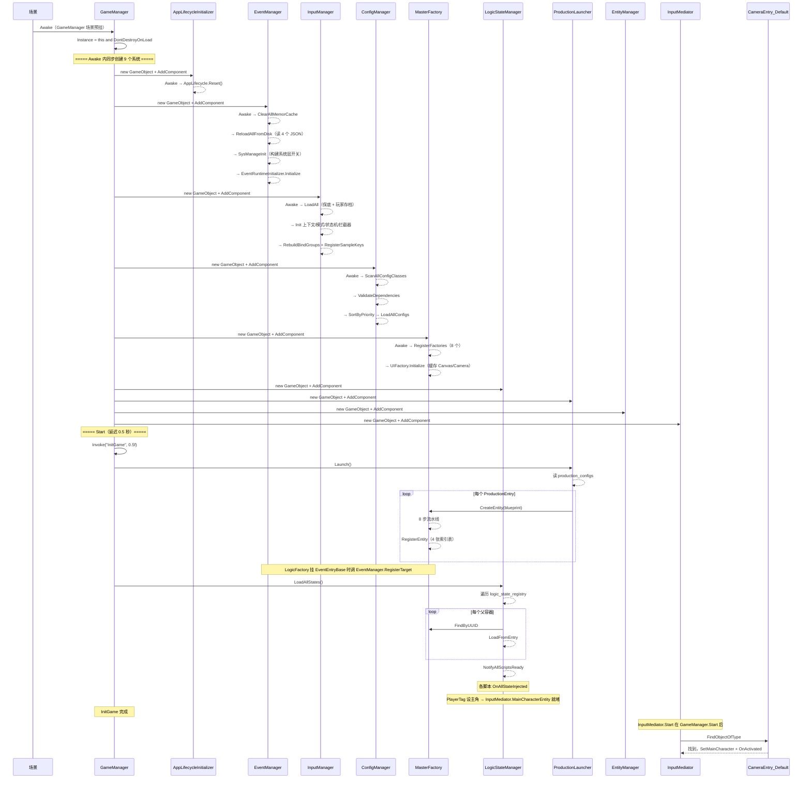
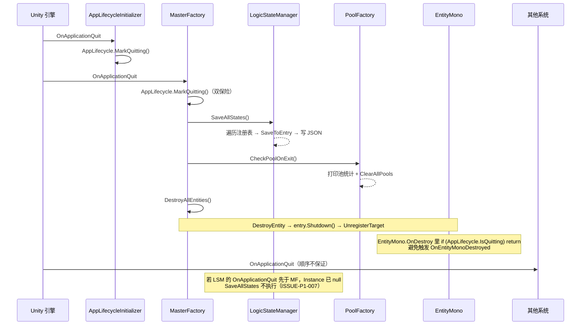

# 第 6 章 总控与启动

> 本章讲 `GameManager`（总控）和 `AppLifecycle`（退出安全）。
> 总控是**全项目的入口**，它决定了 9 个系统的创建顺序；`AppLifecycle` 是**全项目最高优先级的全局状态**，所有涉及销毁/重建的代码都要先查它。
>
> 配套：《已知问题与待修点》ISSUE-P1-007（退出保存顺序）、ISSUE-P1-009（0.5 秒硬编码）、FEAT-007（异步加载器）。

------

## 6.1 系统定位与职责边界

### 总控 `GameManager` 负责什么

| 负责                             | 不负责                                      |
| :------------------------------- | :------------------------------------------ |
| 按依赖顺序创建 9 个系统          | 各系统内部初始化（各系统自己 `Awake` 里做） |
| 延迟初始化游戏内容（`InitGame`） | 实体创建细节（`MasterFactory` 做）          |
| 作为场景唯一入口                 | 业务逻辑（上层脚本做）                      |

### `AppLifecycle` 负责什么

| 负责                                         | 不负责                                                       |
| :------------------------------------------- | :----------------------------------------------------------- |
| 标记"是否正在退出"                           | 退出时各系统该做什么（各系统自己查标记后决定）               |
| 提供 `IsQuitting` / `MarkQuitting` / `Reset` | 编排退出顺序（`MasterFactory.OnApplicationQuit` 自己调保存） |

**边界**：总控只做"编排"，不做"实现"。它不持有任何系统的内部数据，只按顺序 `CreateSystem<T>()`。

------

## 6.2 架构与模块

### 6.2.1 `GameManager`（G_001）

csharp

```c#
public class GameManager : MonoBehaviour
{
    public static GameManager Instance { get; private set; }

    private void Awake()
    {
        if (Instance != null) { Destroy(gameObject); return; }
        Instance = this;
        DontDestroyOnLoad(gameObject);

        // 按依赖顺序创建 9 个系统
        CreateSystem<AppLifecycleInitializer>();
        CreateSystem<EventManager>();
        CreateSystem<InputManager>();
        CreateSystem<ConfigManager>();
        CreateSystem<MasterFactory>();
        CreateSystem<LogicStateManager>();
        CreateSystem<ProductionLauncher>();
        CreateSystem<EntityManager>();
        CreateSystem<InputMediator>();
    }

    private void CreateSystem<T>() where T : MonoBehaviour
    {
        GameObject sysObj = new GameObject("[" + typeof(T).Name + "]");
        sysObj.AddComponent<T>();
        DontDestroyOnLoad(sysObj);
    }

    private void InitGame()
    {
        // 1. 批量生产实体
        ProductionLauncher.Instance.Launch();
        // 2. 加载逻辑状态（注入数据）
        LogicStateManager.Instance.LoadAllStates();
        // 3. 加载地图（当前注释，地图工厂不启用）
        // MasterFactory.Instance.MapFactory.LoadMap("test_map");
    }

    void Start()
    {
        // 延迟一帧，确保配置系统初始化
        Invoke("InitGame", 0.5f);
    }
}
```


**关键点**：

- `Awake` 里 `AddComponent<T>()` 会**立即触发** `T.Awake()`，所以创建顺序就是初始化顺序
- `Start` 里 `Invoke("InitGame", 0.5f)` 延迟初始化（ISSUE-P1-009 待改事件驱动）
- `GameManager` 自身挂场景，其余 9 个系统动态创建（Q58）
- `DontDestroyOnLoad` 保证跨场景不销毁

### 6.2.2 `AppLifecycle` + `AppLifecycleInitializer`（G_002）

csharp

```c#
public static class AppLifecycle
{
    private static bool _isQuitting = false;
    public static bool IsQuitting => _isQuitting;
    public static void MarkQuitting() => _isQuitting = true;
    public static void Reset() => _isQuitting = false;
}

public class AppLifecycleInitializer : MonoBehaviour
{
    private void Awake() => AppLifecycle.Reset();
    private void OnApplicationQuit() => AppLifecycle.MarkQuitting();
}
```


**关键点**：

- `AppLifecycleInitializer` 是 `GameManager.CreateSystem` 的**第一个**系统，`Awake` 里 `Reset()` 清掉上次退出的残留标记
- `OnApplicationQuit` 里 `MarkQuitting()` 标记退出（`MasterFactory.OnApplicationQuit` 里也会调一次，双保险）
- 所有"销毁/重建"代码先查 `AppLifecycle.IsQuitting`（见 6.4）

### 6.2.3 系统创建顺序与依赖理由

| 顺序 | 系统                      | 为什么在这个位置                                             |
| :--- | :------------------------ | :----------------------------------------------------------- |
| 1    | `AppLifecycleInitializer` | 最先重置退出标记，后续系统才能安全查询                       |
| 2    | `EventManager`            | `MasterFactory` 的 `LogicFactory` 挂 `EventEntryBase` 时要调 `EventManager.RegisterTarget`，必须先于工厂 |
| 3    | `InputManager`            | 独立配置体系，不依赖主配置；早创建让 `InputMediator` 能用    |
| 4    | `ConfigManager`           | `MasterFactory.Awake` → `UIFactory.Initialize` 要读 `CanvasRegistryConfig`，必须先于工厂 |
| 5    | `MasterFactory`           | 依赖 2/3/4，且 `LogicStateManager` 要查它的索引表            |
| 6    | `LogicStateManager`       | 依赖 `MasterFactory`（查实体）+ `ConfigManager`（读父容器配置） |
| 7    | `ProductionLauncher`      | 依赖 `MasterFactory`（造实体）+ `ConfigManager`（读 production_configs） |
| 8    | `EntityManager`           | 依赖 `MasterFactory`（批量操作转发）                         |
| 9    | `InputMediator`           | 依赖 `MasterFactory`（查实体）+ `CameraEntry_Default`（场景预挂，Start 里自动找） |

> **为什么 `InputMediator` 最后**：它在 `Start` 里 `FindObjectOfType<CameraEntry_Default>()`，摄像机是场景预挂的，早于所有系统存在（Q61），所以 `Start` 时一定找得到。但 `Update` 里要 `MasterFactory.FindByUUID`，所以 `MasterFactory` 必须先创建。

------

## 6.3 运行时流程

### 6.3.1 启动时序（详细版）




### 6.3.2 每帧流程

总控本身**没有 Update**（`GameManager.Update` 是空的）。每帧由各系统自己驱动：

| 系统                             | 每帧做什么                                                   |
| :------------------------------- | :----------------------------------------------------------- |
| `InputManager.Update`            | 快照刷新 → 组合优先 → 单键兜底 → 写 `_currentOutput`         |
| `InputMediator.Update`           | 拉 `GetStandardOutput` → 给 `CameraEntry` → 拿 `InputOutputPayload` → 按 `ReceiverUuids` 转发 |
| `CameraEntry_Default.LateUpdate` | 更新枪口/准星（`CurrentAimPoint`/`CurrentMuzzlePos`）        |
| `CameraRigScript.Update`         | 鼠标视角旋转 + 快照延迟记录                                  |
| `CameraRigScript.LateUpdate`     | 越肩相机跟随                                                 |
| `AimLineScript.LateUpdate`       | 画枪口→准星线                                                |
| `CharacterInputEntry.Update`     | 轮询 `IsActionHeld` → 移动 + 转身                            |
| `StateMachineScript.Update`      | 限时 Tag 过期清理                                            |
| `EventManager` 协程              | 6 条队列（Logic/Render/Physics/Audio/Input/Network）独立协程派发 |

### 6.3.3 退出流程




**关键点**：

- `AppLifecycle.MarkQuitting()` 在两处调用（`AppLifecycleInitializer` + `MasterFactory`），双保险
- `EntityMono.OnDestroy` 里 `if (AppLifecycle.IsQuitting) return;` 避免退出时触发 `OnEntityMonoDestroyed`（防单例重建，Q14）
- `MasterFactory.OnApplicationQuit` 里主动 `DestroyAllEntities` + 清池 + 保存状态
- ⚠️ 退出保存顺序不保证（ISSUE-P1-007），若 `LogicStateManager` 先销毁，状态丢失

------

## 6.4 退出安全机制（重点）

### 为什么需要 `AppLifecycle`

**问题场景**（Q14 原话）：

> "暴力销毁实体会反注册，但如果工厂单例先销毁，实体会触发 `OnEntityMonoDestroyed` → 重建工厂单例 → 状态异常"

**解决**：

1. `AppLifecycle.IsQuitting` 全局标记
2. 所有"销毁/重建"代码先查标记
3. 退出阶段直接跳过，不触发重建

### 哪些地方查了 `AppLifecycle`

| 位置                                           | 代码                                                         | 作用                                 |
| :--------------------------------------------- | :----------------------------------------------------------- | :----------------------------------- |
| `EntityMono.OnDestroy`（F_003）                | `if (AppLifecycle.IsQuitting) return;` + `if (MasterFactory.Instance == null) return;` | 退出时不触发 `OnEntityMonoDestroyed` |
| `MasterFactory.OnEntityMonoDestroyed`（F_012） | `if (AppLifecycle.IsQuitting || _isDestroyed) return;`       | 双保险                               |
| `MasterFactory.Instance` getter（F_012）       | `if (AppLifecycle.IsQuitting || _isDestroyed) return _instance;` | 退出时不重建单例                     |

### `AppLifecycle.Reset` 的可靠性

- `AppLifecycleInitializer` 是 `GameManager.CreateSystem` 的**第一个**系统，`Awake` 里 `Reset()`
- 每次进播放模式，`AppLifecycleInitializer.Awake` 一定先执行（因为 `GameManager.Awake` 第一行就创建它）
- 关闭 Domain Reload 时静态 `_isQuitting` 残留 true，`Awake` 里 `Reset` 能清掉（Q59，机制可靠）

------

## 6.5 扩展指南

### 加一个新系统

1. 写系统类 `XxxManager : MonoBehaviour`，`Awake` 里做自己的初始化
2. 在 `GameManager.Awake` 里 `CreateSystem<XxxManager>()`，**按依赖顺序放对位置**
3. 如果需要场景预挂的依赖（如摄像机/画布），在 `Start` 里 `FindObjectOfType` 自动找
4. 如果涉及销毁/重建，先查 `AppLifecycle.IsQuitting`
5. 如果需要退出保存，在 `OnApplicationQuit` 里调自己的保存方法（注意 ISSUE-P1-007）

### 加一个退出时保存的系统

1. 系统类实现 `SaveAll()` 方法
2. 在 `MasterFactory.OnApplicationQuit` 里**按顺序**调用（`MasterFactory` 是退出编排的权威入口）
3. 注意：若你的系统可能在 `MasterFactory` 之前被销毁，考虑用 `Application.wantsToQuit` 统一编排（ISSUE-P1-007 的修复方案）

### 改初始化延迟

当前 `Invoke("InitGame", 0.5f)` 是硬编码（ISSUE-P1-009 / FEAT-007）。改为事件驱动：

csharp

```c#
// 方案：ConfigManager 加载完成后触发
ConfigManager.Instance.OnAllConfigsLoaded += () => InitGame();
```


或引入异步资源加载器后统一编排。

------

## 6.6 已知限制与注意事项

| 编号         | 问题                                                         | 优先级            |
| :----------- | :----------------------------------------------------------- | :---------------- |
| ISSUE-P1-007 | 退出保存顺序不保证，`LogicStateManager` 可能先销毁           | P1                |
| ISSUE-P1-009 | `Invoke("InitGame", 0.5f)` 硬编码延迟                        | P1                |
| ISSUE-P2-017 | Domain Reload 关闭时 `EventRuntimeInitializer._initialized` 残留（影响事件系统初始化） | P2                |
| NOTE-023     | 退出保存顺序                                                 | 关联 ISSUE-P1-007 |
| NOTE-024     | 0.5 秒硬编码                                                 | 关联 ISSUE-P1-009 |

### 设计约定

- **`GameManager` 挂场景，其余 9 个系统动态创建**（Q58）
- **`AppLifecycleInitializer` 必须是第一个创建的系统**，否则退出标记重置不及时
- **`MasterFactory` 是退出编排的权威入口**，所有退出保存/清理在它的 `OnApplicationQuit` 里按顺序调
- **`GameManager.Update` 为空**，每帧由各系统自己驱动

### 隐性依赖

- `InputMediator` 依赖 `CameraEntry_Default` 场景预挂（Q61），所以 `Start` 里 `FindObjectOfType` 一定找得到
- `MasterFactory.Awake` 里 `UIFactory.Initialize` 依赖 `ConfigManager` 已加载完 `CanvasRegistryConfig`（所以 `ConfigManager` 必须在前）
- `LogicFactory` 挂 `EventEntryBase` 依赖 `EventManager` 已创建（所以 `EventManager` 必须在前）

------

## 6.7 依赖关系

text

```
GameManager（入口）
    │
    ├─ 依赖：无（场景预挂，第一个执行）
    │
    ├─ 创建（按顺序）：
    │   ├─ AppLifecycleInitializer → 被 EntityMono/MasterFactory 查询
    │   ├─ EventManager → 被 LogicFactory（挂 EventEntryBase 时）使用
    │   ├─ InputManager → 被 InputMediator（拉输出）使用
    │   ├─ ConfigManager → 被 MasterFactory（UIFactory.Initialize）使用
    │   ├─ MasterFactory → 被 LogicStateManager/ProductionLauncher/EntityManager/InputMediator 使用
    │   ├─ LogicStateManager → 被 MasterFactory.OnApplicationQuit（保存）使用
    │   ├─ ProductionLauncher → 被 GameManager.InitGame 调用
    │   ├─ EntityManager → 被业务层（批量操作）使用
    │   └─ InputMediator → 被 CameraEntry_Default（读 MainCharacterEntity）使用
    │
    └─ 被依赖：无（最顶层）
```


**被谁依赖**：无（总控是最顶层，没有系统依赖总控，总控也不被任何系统依赖）

**依赖谁**：全部 9 个系统（创建它们），但不持有它们的内部数据

------

**第 6 章结束。**