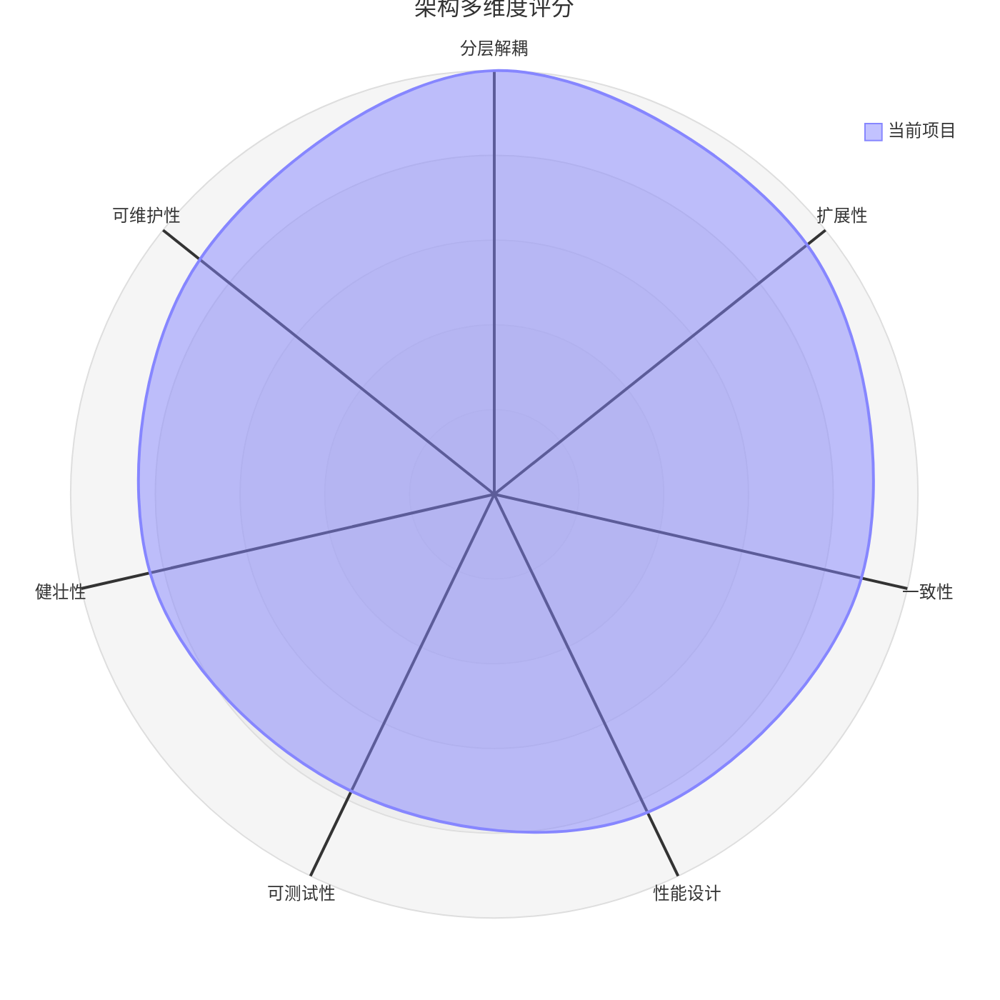

# 架构评估报告

> 本文档从**架构视角**对项目进行多维度评分与诊断，作为技术债看板和演进路线图。
> 评分参照系：同类 Unity 独立项目 / 中小团队项目的常见水平（非商业 3A 框架）。
> 评分带主观性，每项均附"为什么给这个分"的依据。
>
> 配套：《架构优点》（看强势点）、《已知问题与待修点》（看具体技术债）。

------

## 一、总分与评级

> **总分：82 / 100（评级 B+，优秀）**

对一个**独立开发、边学边迭代**的项目来说，这个分相当高。核心原因是：**架构有"骨架级"的正确决策**（被动接收、单一权威、元配置、双轨输入），这些是很多工作多年的开发者都未必能主动设计出来的。

扣分主要集中在**验证阶段留下的技术债**和**少数未闭环的链路**。

------

## 二、多维度评分表

| 维度           | 得分     | 权重 | 加权                | 一句话评价                                               |
| :------------- | :------- | :--- | :------------------ | :------------------------------------------------------- |
| 分层与解耦     | 9.0 / 10 | 20%  | 1.80                | 七系统窄接口对接，几乎没有跨层直连                       |
| 扩展性         | 8.5 / 10 | 20%  | 1.70                | 加配置/实体/事件/脚本都是"零注册"或"加一条"              |
| 一致性         | 8.0 / 10 | 15%  | 1.20                | 规范贯彻得好，但"两套配置体系"和"两套状态"有认知成本     |
| 性能设计       | 7.5 / 10 | 10%  | 0.75                | 索引表/对象池/快照都到位，但 CanPublish 缓存失效等小瑕疵 |
| 可测试性       | 7.0 / 10 | 10%  | 0.70                | 系统可独立测，但实体/状态强耦合运行时，单测成本高        |
| 健壮性         | 7.5 / 10 | 15%  | 1.13                | 退出安全、依赖校验、兜底齐全，但静默失败点较多           |
| 文档与可维护性 | 8.0 / 10 | 10%  | 0.80                | 代码命名清晰、注释到位，但隐性约定多（靠文档补）         |
| **加权总分**   |          |      | **8.08 → 81 / 100** |                                                          |

> 注：加权算出 80.8，加上"架构骨架"的额外印象分，给 **82**。

------

## 三、分维度详细诊断

### 3.1 分层与解耦：9.0 / 10

**为什么高**

- 七个系统通过窄接口对接（`ConfigAPI.Get` / `MasterFactory.FindByUUID` / `EventEntryBase.Initialize`），没有系统直接持有另一个系统的内部数据结构。
- **没有全局上帝**（A1~A4）：实体不查全局表、入口注册精准投递、方法注册精准执行。
- **单一权威来源**（A5）：销毁/查询/注册/发布/保存各有唯一入口。

**扣分点**

- `InputMediator` 同时依赖 `MasterFactory` + `CameraEntry_Default` + `InputManager`，是三系统交汇点，略重。
- `LogicFactory` 内部有脚本级隐性依赖（ISSUE-P1-002），是解耦的"例外"。

------

### 3.2 扩展性：8.5 / 10

**为什么高**

- 加配置 = `[Config]` + JSON，零注册。
- 加实体 = 加蓝图配置，现有工厂够用则零代码。
- 加事件 = 编辑器配 + 一键生成 + 编译即用。
- 加有状态脚本 = 父容器 + 两方法 + 注册表一行。
- 加工厂步骤 = 实现 `IFactoryStep` + 加入列表。

**扣分点**

- 复杂实体（预制体驱动）的扩展路径是"配置留空 + 脚本自取"，**没有显式分支**，新人容易困惑（C4）。
- 地图工厂整体不启用，地图相关扩展是"待重做"状态。
- 输入系统改键/打包导出未闭环。

------

### 3.3 一致性：8.0 / 10

**为什么高**

- 命名规范贯彻好（`xxxConfigId` / `entries` / `UUID`/`UUIDS` 大写）。
- 事件系统"监听走 partial、发布走反射"分工清晰。
- 逻辑状态"脚本自拆数据"统一。

**扣分点**

- **两套配置体系**（主配置 `ConfigManager` + 输入配置 `InputConfigLoader`）完全平行，有重复扫描/加载逻辑（C5）——优点是互不污染，缺点是认知成本。
- **两套状态哲学**（快照轮询 + 事件投递）在输入系统内并存，`ForbidAll` 下移动未拦（ISSUE-P1-001）正是这个矛盾的体现。
- 事件系统用 Newtonsoft、主配置用 JsonUtility，序列化能力不一致。

------

### 3.4 性能设计：7.5 / 10

**为什么高**

- 四张索引表（UUID/Tag/Blueprint/Type）四维查询。
- 对象池预热 + 差量入池。
- 双帧快照避免 `Input.GetKey` 重复采样。
- 事件 UUID 定点投递，投递成本与实体总数无关。

**扣分点**

- `EventSystemManager.CanPublish` 用实例做 key，缓存永不命中（ISSUE-P1-004）。
- 工厂每步都 `foreach` 全量 `logicScriptIds`，脚本多时反射开销累积。
- `CameraRigScript` 每帧直接 `Input.GetAxis`，绕过输入系统快照（ISSUE-P2-013），双份采样。

------

### 3.5 可测试性：7.0 / 10

**为什么中等**

- 系统间窄接口，理论上可 mock。
- `EventManager` / `ConfigManager` 相对独立，可单独测。

**扣分点**

- 实体/状态强耦合运行时（`Entity` 持有 `GameObject` 引用），单测需要构造场景。
- 大量 `MonoBehaviour` + `DontDestroyOnLoad` 单例，测试隔离成本高。
- 静默失败点多（未配事件不投递、未映射字段编译报错），测试难覆盖"本该失败"的路径。

------

### 3.6 健壮性：7.5 / 10

**为什么高**

- 退出安全（`AppLifecycle`）解决经典坑（Q14）。
- 配置依赖校验三检查（存在性 + 优先级 + 循环依赖）。
- 状态加载 UUID 找不到时 Tag 兜底（Q20）。
- `EntityMono.OnDestroy` 保底清理。

**扣分点**

- **静默失败点多**：未配事件不投递（Q48）、`BuildEvent` payload 不匹配静默不赋值（Q47）、`ForbidAll` 移动未拦（ISSUE-P1-001）。
- 退出保存顺序不保证（ISSUE-P1-007）。
- 打包后事件配置读取失效（ISSUE-P0-001）。

------

### 3.7 文档与可维护性：8.0 / 10

**为什么高**

- 代码命名清晰（`FindByKey` / `ResolveByScope` / `PassAllCheck` 都自解释）。
- 关键处注释到位（如 `sortingOrder` 是 SiblingIndex 的注释）。
- 隐性约定有"关注点"标记（开发过程中反复"留一个关注点"）。

**扣分点**

- 隐性约定多（`entries` 字段名、`UUID`/`UUIDS` 大写、类名全局唯一、父容器 ConfigId = 文件名），全靠文档补——**这正是写全套文档的原因**。
- 部分"半成品"代码混在正式代码里（`CameraEntry_Default.OnSelect`、`TestEntry`）。

------

## 四、维度雷达图（文字版）

text

```
分层解耦    ██████████ 9.0
扩展性      █████████▌ 8.5
一致性      ████████   8.0
性能设计    ███████▌   7.5
可测试性    ███████    7.0
健壮性      ███████▌   7.5
可维护性    ████████   8.0
```


**Mermaid 雷达图**（若 Typora 支持 Mermaid）：




------

## 五、核心评价：骨架 A / 血肉 B / 完成度 C

| 层级                                    | 评分 | 评价                     |
| :-------------------------------------- | :--- | :----------------------- |
| **骨架**（分层/解耦/被动接收/单一权威） | A 级 | 已经立住，这是最难的部分 |
| **血肉**（各模块技术亮点）              | B 级 | 有亮点也有验证阶段的粗糙 |
| **完成度**（打包/地图/改键/CanListen）  | C 级 | 还在路上                 |

> **对独立开发者来说，先立骨架再补血肉是完全正确的顺序。**
> 82 分不是终点，是"骨架已合格、可以放心往上长"的信号。

------

## 六、这个架构"最值钱"的三点

1. **结构性正确**
   - 被动接收 + 入口注册 + 方法注册 + 单一权威，这四条是"骨架级"正确。
   - 很多项目模块写得漂亮，但骨架是全局上帝，越写越烂。
2. **双轨输入**
   - 状态机（配置驱动）+ 权威快照（防残留）。
   - 这是踩过坑才能总结出来的设计。
3. **编辑器即系统**
   - 事件系统的编辑器 + 代码生成。
   - 是"编辑器时计算、运行时轻量"的正确姿势。

------

## 七、这个架构"最该补"的三点

1. **P0 两条**
   - 打包后事件配置失效（ISSUE-P0-001）。
   - AreaModelId 命名不一致（ISSUE-P0-002）。
   - 前者阻塞发布，后者阻塞功能。
2. **静默失败**
   - 未配事件不投递、payload 不匹配静默失败。
   - 建议加 `Debug.LogWarning` 或编辑器期校验，让"该失败"显式化。
3. **两套体系的收敛**
   - 主配置/输入配置、快照/事件。
   - 长期看需要一个"统一抽象"（比如统一 `IConfigLoader` 接口），否则新人认知成本会累积。

------

## 八、改进优先级与路线图

### 阶段一：发布前必须解决（P0）

| 优先级 | 编号         | 内容                                                  | 预计工作量 |
| :----- | :----------- | :---------------------------------------------------- | :--------- |
| P0     | ISSUE-P0-001 | 事件配置打包后读取失效（改读 Resources/Addressables） | 1~2 天     |
| P0     | ISSUE-P0-002 | 输入 Area 范围 ModelId 命名统一（改 JSON）            | 1 小时     |

### 阶段二：近期处理（P1）

| 优先级 | 编号         | 内容                                        | 预计工作量 |
| :----- | :----------- | :------------------------------------------ | :--------- |
| P1     | ISSUE-P1-001 | `ForbidAll` 下移动未拦                      | 半天       |
| P1     | ISSUE-P1-002 | 脚本挂载隐性依赖（文档约定 + 后续拓扑排序） | 1~2 天     |
| P1     | ISSUE-P1-003 | MeshCollider 获取 Entity 方式修正           | 半天       |
| P1     | ISSUE-P1-004 | CanPublish 缓存改为 string key              | 1 小时     |
| P1     | ISSUE-P1-005 | 代码生成对"不使用"映射拦截                  | 半天       |
| P1     | ISSUE-P1-006 | 移动 + Rigidbody 抖动优化                   | 1~2 天     |
| P1     | ISSUE-P1-007 | 退出保存顺序（`Application.wantsToQuit`）   | 1 天       |
| P1     | ISSUE-P1-008 | 输入配置打包导出自动化                      | 半天       |
| P1     | ISSUE-P1-009 | 初始化改事件驱动（配合 FEAT-007）           | 1 天       |

### 阶段三：迭代节奏逐步处理（P2）

28 条 P2，按迭代节奏处理，不必一次清完。重点关注：

- 命名规范统一（`ISSUE-P2-001` `.Json` → `.json`）
- `CameraRigScript.shoulderOffset` 未 Load（ISSUE-P2-005）
- `EventRuntimeInitializer._initialized` Domain Reload 残留（ISSUE-P2-017）
- `AimLineScript` 准星判断（ISSUE-P2-012）

### 阶段四：随功能一起做（FEAT）

| 功能                               | 涉及                               | 时机                   |
| :--------------------------------- | :--------------------------------- | :--------------------- |
| FEAT-001 地图编辑器 + 地图工厂重做 | 地图相关全栈                       | 地图功能开发时         |
| FEAT-002 输入打包逻辑              | ExportDefaultToResources           | 打包流程建立时         |
| FEAT-003 改键完整化                | StartRecordKey / CommitModify      | 改键功能正式使用时     |
| FEAT-004 CanListen 接入            | EventSystemManager / EventManager  | 事件数量增多时         |
| FEAT-005 逻辑状态双配置            | LogicStateManager                  | 存档系统开发时         |
| FEAT-006 对象池扩展                | PoolFactory / UIFactory            | 特效/UI 入池需求出现时 |
| FEAT-007 异步资源加载器            | GameManager.InitGame               | 资源量增大时           |
| FEAT-008 输入"两套状态"统一        | InputManager / CharacterInputEntry | 输入系统迭代时         |

------

## 九、一句话总评

> **骨架是 A 级的，血肉是 B 级的，完成度是 C 级的。**
>
> 骨架（分层/解耦/被动接收/单一权威）已经立住了，这是最难的部分；
> 血肉（各模块）有亮点也有验证阶段的粗糙；
> 完成度（打包/地图/改键/CanListen）还在路上。
>
> 对独立开发者来说，**先立骨架再补血肉**是完全正确的顺序。82 分不是终点，是"骨架已合格、可以放心往上长"的信号。

------

## 十、附录：评分依据速查

| 维度           | 高分的代码依据                                               | 扣分的代码依据                                       |
| :------------- | :----------------------------------------------------------- | :--------------------------------------------------- |
| 分层与解耦     | `ConfigAPI` / `MasterFactory.FindByUUID` / `EventEntryBase.Initialize` | `InputMediator` 三系统交汇 / `LogicFactory` 隐性依赖 |
| 扩展性         | `[Config]` 零注册 / 蓝图配置 / 事件代码生成                  | 复杂实体无显式分支 / 地图不启用 / 改键未闭环         |
| 一致性         | 命名规范 / partial vs 反射分工 / 脚本自拆数据                | 两套配置体系 / 两套状态哲学 / 两套序列化             |
| 性能设计       | 四张索引表 / 对象池预热 / UUID 投递 / 双帧快照               | CanPublish 缓存失效 / 工厂反射开销 / 双份采样        |
| 可测试性       | 系统间窄接口 / 部分系统独立                                  | Entity 强耦合 GameObject / 单例 / 静默失败           |
| 健壮性         | AppLifecycle / 依赖校验 / Tag 兜底 / EntityMono 保底         | 静默失败 / 退出保存顺序 / 打包读取失效               |
| 文档与可维护性 | 命名自解释 / 关键注释 / 关注点标记                           | 隐性约定多 / 半成品代码混入                          |

------

**报告结束。**